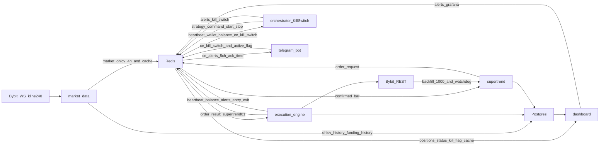
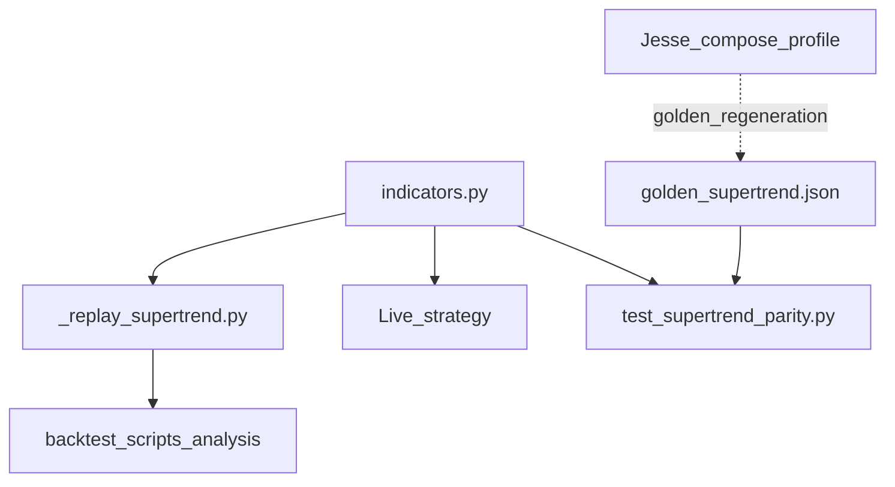

# Supertrend 단일 전략 런타임 단순화 계획

> 2026-10-05 초안(`da59804a`)을 같은 날 코드·라이브 컨테이너 대조로 검토하고 다시 쓴 판이다. 운영 컨테이너, 전략 파라미터, Kill Switch 코드는 이 문서 작성으로 수정하지 않았다. 구현은 사용자가 1단계를 실행하라고 말하고, 아래 "사용자 결정" 항목에 답한 뒤에만 시작한다.

**Goal:** Supertrend 4h BTC·Bybit 메인넷이 지금처럼 안전하게 도는 것을 유지한다. 멀티전략·멀티심볼 시대의 잔재(소비자 없는 시세, 죽은 채널, 죽은 설정, 사실과 다른 문서, 비대한 이미지)를 걷어낸다. 무엇을 지금 지우고 무엇을 남길지 실행 가능한 단계로 고정한다.

**Architecture:** 1단계는 프로세스 경계와 Redis 계약을 유지한 채 죽은 것만 지운다. 2단계(단일 프로세스 병합)는 검토 결과 비용 대비 이득이 작아 **보류(권고하지 않음)**로 내렸다. 백테스트 기준선은 `indicators.py`를 라이브러리로 임포트하는 리플레이다. Jesse Compose는 골든 재생성용 레거시로 둔다.

**Tech Stack:** Python asyncio, Docker Compose, Redis 7 (유지), Postgres 16 (유지), Bybit WS/REST, 기존 pytest 패리티·주문 상태 테스트.

**Spec:** 사용자 요청(2026-10-05). 전략은 확정이고 거래소 확장은 없다. 목적은 안정 운영과 백테스트 유지다. 본문은 Redis pub/sub가 필요한지에 대한 답과 불필요한 파일·메모리·구조의 제거다.

## Global Constraints

아래는 어떤 단계에서도 깨면 안 되는 운영 불변식이다. 출처는 [AGENTS.md](../AGENTS.md)와 라이브 코드.

- `BYBIT_TESTNET=false`. 테스트넷 전환은 포지션 수동 청산 후에만 한다.
- [`cryptoengine/shared/kill_switch.py`](../cryptoengine/shared/kill_switch.py) 로직 수정 금지. 호출만 한다. 이 파일은 Redis를 임포트하지 않고 `KILL_SWITCH_ACTIVE_KEY` 상수만 정의한다(`:33`).
- 레버리지 하드캡 `SAFETY_LEVERAGE_LIMIT=3.0`. 진입 주문은 SafetyGuard가 초과를 막는다.
- BTCUSDT 무기한 단일. 다중 심볼 추가 금지. 만기물(`BTCUSDT-25SEP26` 등) 캐시 잔재도 다시 만들지 않는다.
- 지정가·post-only 우선. 시장가는 세 경우에만 쓴다: 리페그 소진 후 잔량 폴백(`order_manager.py:315-336`), `on_stop` 청산(`strategy.py:285`), 긴급 청산.
- 배분은 고정 95%×3x다(`strategy.py:414,536` 하드코딩). 레짐 배분을 되살리지 않는다.
- 배포·재시작은 포지션을 청산하지 않는다. `service_shutdown`은 [`strategy.py`](../cryptoengine/services/strategies/supertrend/strategy.py) `:73`의 `_SHUTDOWN_NO_LIQUIDATE`에 들어 있다. 그 밖의 stop 사유(`kill_switch`, `telegram_pause`, `orchestrator_stop`)는 **청산한다.**
- 브랜치는 `main`만 쓴다. 피처 브랜치를 만들지 않는다.
- 콤보 #7908 파라미터(st_factor 2.6, st_period 9, EMA 7/29, dir_ema 240, ATR 3.3, 4h 확정봉)와 `CANDLE_LOOKBACK=1000`은 이 단순화로 바꾸지 않는다.
- 코드 변경 커밋은 Doc-Sync를 따른다. 트리거 맵에 행이 없는 경로(market-data, orchestrator, telegram-bot, requirements, prometheus 설정)도 아래 "Doc-Sync 매핑"대로 같은 커밋에서 문서를 고친다.

## 검토 결과 요약 (2026-10-05)

초안을 코드 file:line과 라이브 Redis·`docker stats` 3회 샘플로 대조했다. 초안의 큰 방향(Redis는 자원 문제가 아니고, 1단계는 죽은 것만 지운다)은 맞았다. 세부는 아래처럼 틀리거나 빠져 있었다.

| 초안 주장 | 판정 | 실제 |
|---|---|---|
| node-exporter가 CPU 1위 | 틀림 | 3회 샘플 모두 0.00%. 스크랩 1회에 평균 1.5초(2,203 샘플)가 걸려 15초마다 순간 버스트가 난다. 상시 부하는 market-data다(지속 약 3~4%). |
| `ce:alerts:funding`, `ce:alerts:daily_report`는 발행만 있음 | 반대 | 텔레그램이 **구독**하고(`telegram-bot/main.py:83,86`), 발행자가 없다. |
| Funding 알림이 필요하면 `market:funding`만 남긴다 | 틀림 | 펀딩 경보는 `funding_monitor._check_alerts` → `ce:alerts:anomaly`(`funding_monitor.py:441`)로 간다. `market:funding:*`는 구독자가 없다. 텔레그램 일일리포트의 `GET market:funding:bybit:BTCUSDT`(`handlers.py:573`)는 채널 이름을 키로 읽어 항상 nil이다. |
| `order:result`는 내부 버스 | 부분 | 서비스 구독자는 없다. 소비되는 것은 `order:result:supertrend-01`뿐이다. `manual_close_delayed.py:102`는 두 채널을 모두 구독한다. |
| `cache:wallet_balance`가 사이징 입력 | 틀림 | 사이징과 SafetyGuard 레버리지 검사는 `cache:balance:bybit`(`strategy.py:69,928`; `safety.py:628,661`)를 읽는다. `cache:wallet_balance`는 orchestrator `portfolio_monitor.py:160`(Kill Switch equity)이 읽는다. 둘 다 execution-engine이 쓴다(`execution/main.py:320-321`). |
| `emergency_close_all.py`가 `ce:kill_switch:active`를 읽음 | 틀림 | SET만 한다(`:120`). 읽는 곳은 SafetyGuard, 텔레그램(`handlers.py:372,655`), **대시보드**(`internal.ts:105`, `monitor.ts:146`)다. |
| 대시보드는 Redis와 무관(2단계 Redis 제거 가능) | 틀림 | 대시보드는 ioredis로 키 10여 개를 읽고 `ce:alerts:grafana`를 발행한다. 아래 Redis 인벤토리 D 참조. |
| 라이브 다이어그램이 Redis 사용처 전부 | 부족 | `ce:alerts:{entry,exit,kill_switch,anomaly,grafana}` 5개 채널, heartbeat, `ce:kill_switch:ack_time`, 포지션·손절 캐시가 빠져 있었다. |
| 리플레이 데이터는 `btc_4h_extended.csv` | 틀림 | 기본은 `btc_4h.csv`(`_replay_supertrend.py:451`, 2017-08-17~2026-04-30)다. extended로 돌리면 208 trades / CAGR 211.59% / MDD −66.70% / Sharpe 1.651이다. |
| `test_supertrend_parity.py`가 리플레이를 씀 | 틀림 | 패리티는 `indicators.py`와 Jesse 골든 `fixtures/golden_supertrend.json`(`:55`)의 비교다. |
| market-data에 다른 kline 주기가 있음 | 해당 없음 | WS는 `kline.240`만 구독한다(`collector.py:41,167`). Redis에 남은 `cache:ohlcv:*:{1m,5m,15m,1h}`와 만기물 키는 TTL 없이 34일 이상 갱신이 없는 잔재다. |
| `bybit.yaml`의 orderbook 토픽이 수집기와 중복 | 죽은 설정 | `public_topics`/`private_topics`는 어떤 코드도 읽지 않는다. 수집기는 `_core_topics()`에 하드코딩한다. |
| yaml은 죽었고 코드 상수가 권위 | 부분 | `model.*`, `sizing.*`(`candle_lookback` 포함), `phase5.*`, `risk.*`는 죽었다. **최상위 `leverage: 3.0`, `tick_interval`, `max_orders_per_*`는 라이브에 쓰인다**(`strategy.py:89`, `base_strategy.py:60-64`). 최상위에 `st_factor` 같은 키를 두면 상수를 덮어쓴다(`strategy.py:83-89`). |
| orchestrator.yaml 키 정리는 safety.md와 무관 | 틀림 | 이 파일은 Doc-Sync 트리거 #16(→ `safety.md`)이다. |
| 배포 후 `grep 복구`로 확인 | 틀림 | 전략은 재시작 때 "복구"를 로그하지 않는다. 실제 신호는 `candles_backfilled`, `missed_bar_on_start`, `position_state_divergence`, `bar_watchdog_recovered`다. |
| `service_shutdown` 후 Redis 스냅샷 복구, 1시간 제한 | 거짓 | `strategy:saved_state:*`는 쓰는 곳도 읽는 곳도 없다. 복구에 1시간 제한은 없다. AGENTS.md:18,70, `60-runtime.md:109-133`, `safety.md:244-266`, `40-data.md:370`, `glossary.md:342`가 틀렸다. |
| 1단계 테스트 묶음 | 확인 | 11개 파일 모두 있다. 2026-10-05 로컬 실행에서 unit 6개 파일 93 passed, integration·alert 5개 파일 37 passed. 리플레이는 198 / 219.06% / −66.70% / 1.667로 일치했다. 호스트에 `python`이 없으니 `python3`을 쓴다. |

## 계획 밖 안전 발견 (사용자 결정 필요)

단순화 검토 중 나온 **기존** 결함이다. 이 계획의 1단계는 아래를 고치지 않는다. 문서에 사실로 적는 것만 1E에 포함한다. 고치려면 각각 별도 승인과 별도 커밋이 필요하다. `kill_switch.py`는 어느 것도 건드리지 않는다.

- **S1. 자동 Kill이 신규주문 차단 키를 세우지 않는다.**
  - `ce:kill_switch:active`를 SET하는 곳은 텔레그램 `/emergency_close`(`handlers.py:193`)와 `emergency_close_all.py:120`뿐이다.
  - orchestrator의 자동 Kill(drawdown, dead-man)은 `_on_kill_switch_trigger`(`core.py:295-380`)에서 전략 stop 명령과 알림만 낸다. 그다음 cooldown 동안 start 재발행을 건너뛴다(`core.py:266-269`).
  - 그래서 자동 Kill 뒤의 차단은 SafetyGuard 게이트가 아니라 "전략이 멈춰 있음"에 기대고 있다. 해제하는 코드도 없어서, 수동 Kill 뒤에는 사람이 `SET ... 0`을 해야 한다.
  - 강화 방향은 orchestrator `core.py`에서 SET하는 것이다. 다만 cooldown 해제와 같이 설계해야 하고, 그러지 않으면 자동 재개가 막힌다. 별도 과제.
- **S2. orchestrator 재시작이 Kill 상태를 지운다.**
  - KillSwitch 상태는 orchestrator 메모리에만 있다. Kill cooldown 중에 orchestrator를 재시작하면 다음 루프(≤300초)에 `start`가 다시 나가서 전략이 재개된다.
  - 1단계 운영 규칙: **Kill 활성 또는 cooldown 중에는 orchestrator를 재시작하지 않는다.** 1C의 orchestrator 이미지 교체도 이 조건을 지킨다.
- **S3. SafetyGuard 시세 키가 불일치해 슬리피지 검사가 꺼져 있다.**
  - SafetyGuard는 `cache:ticker:bybit:<symbol>`를 읽는다(`safety.py:591`). 이 키를 쓰는 곳이 없다. market-data는 `cache:price:*`를 쓴다.
  - 결과 1: 지정가의 가격 괴리 검사는 "no market price, allowing order"로 항상 통과한다(`safety.py:482-490`).
  - 결과 2: 가격 없는 시장가(리페그 폴백, `on_stop` 청산)의 명목가는 수량 자체로 추정된다(`safety.py:574-580`). 그래서 최대주문·레버리지 검사가 사실상 통과한다.
  - 지정가 진입은 `price`가 있어 레버리지 검사가 정상이다(`safety.py:406`).
  - 고치면 메인넷 주문이 거절되기 시작할 수 있는 동작 변경이다. 1A의 ticker 제거 여부가 이 결정에 묶인다(1A 참조).
- **S4. 텔레그램 명령 5개가 조용한 no-op이다.**
  - `/start`, `/stop`, `/weight`는 구독자 없는 `ce:strategy:command`로 보낸다(`handlers.py:335,388,445`).
  - `/pause_all`, `/resume_all`은 `strategy:command:supertrend-01`로 보내지만 `strategy_id`가 빠져(`handlers.py:626,663`) Pydantic 검증에서 버려진다(`base_strategy.py:134`).
  - 사용자에게는 "전송됨"으로 보인다. 실제로 동작하는 수동 경로는 `/emergency_close`와 `emergency_close_all.py`뿐이다.
  - `/pause_all`을 "고치면" `telegram_pause` 사유로 **포지션이 청산된다**(`_SHUTDOWN_NO_LIQUIDATE` 밖). 1B는 고치지 않고 정직하게 만든다(아래 1B).
- **S5. 재시작 직후 쿨다운이 사라진다.** `_last_liquidation_ts`, `_atr_cooldown_until`은 메모리에만 있다(`strategy.py:103-104`). ATR 청산 직후 supertrend를 재시작하면 같은 봉 재진입 방지가 사라진다. 배포 규칙: **ATR 손절 직후 다음 4h 봉 전에는 supertrend를 재시작하지 않는다.**
- **S6. 대시보드 Rule 3이 늘 발화 조건이다.**
  - `ohlcv_history`의 `MAX(timestamp)`는 봉 시작 시각이고 4h 봉만 저장된다. 그래서 "600초 초과" 조건(`alertEvaluator.ts:110-122`)이 거의 항상 참이다.
  - 1A로 다른 신호가 줄면 이 거짓 경보가 더 두드러진다. 기준을 "마지막 4h 봉 시작 + 4h + 10분"으로 바꾸는 대시보드 수정은 별도 커밋이다.

## 결론 (먼저)

Redis pub/sub는 자원 때문에 걷어낼 이유가 없다. `cryptoengine-redis-1`은 5.2MiB, CPU 0.5~2.4%였다.

Redis를 남길 이유는 구조에 있다. 프로세스가 나뉜 지금 Redis는 6가지 역할을 한다. 그리고 대시보드가 Redis에 크게 의존한다.

- 주문 버스
- 4h 봉 전달
- 텔레그램 긴급청산
- `ce:kill_switch:active` fail-closed 게이트: [`safety.py`](../cryptoengine/services/execution/safety.py) `_check_kill_switch`(`:307-338`)가 읽기 실패 시 주문을 막는다.
- dead-man heartbeat
- 텔레그램 알림 5채널

단일 프로세스로 합쳐도 대시보드·텔레그램·긴급청산 때문에 Redis는 남는다. 그래서 2단계의 이득은 프로세스 4개 → 1개로 생기는 RAM 약 100~150MiB와 재시작 순서 레이스 제거뿐이다. 비용은 주문·청산·복구·Kill 경로 전체의 재검증과 S1·S2·S5를 먼저 고치는 일이다. **2단계는 보류한다.**

1단계의 실제 이득은 세 가지다. 런타임 RAM 절감은 수십 MiB 이하로 작다고 본문에서 미리 밝힌다.

1. market-data의 상시 CPU(소비자 없는 orderbook/trades WS 처리)
2. 이미지 크기와 빌드 시간: market-data 877MB, orchestrator 1.19GB, supertrend 859MB
3. 죽은 채널·설정·명령·문서 제거. 운영자가 잘못 믿을 수 있는 거짓 계약을 없앤다.

백테스트는 라이브 메시와 묶여 있지 않다. 기준 경로는 [`_replay_supertrend.py`](../cryptoengine/tests/fixtures/_replay_supertrend.py)가 [`indicators.py`](../cryptoengine/services/strategies/supertrend/indicators.py)를 임포트하는 것이다(`:46-50`). 이 경계는 어느 단계에서도 바꾸지 않는다.

## 실측 (2026-10-05, docker stats 3회 ~10초 간격 + 초안 1회)

RSS이지 limit이 아니다. CPU는 한 코어 대비 %다.

| 컨테이너 | CPU (3회) | MEM / limit | 판단 |
|---|---|---|---|
| market-data | 1.7 / 5.1 / 2.1% (`/proc` 20초: 4.4%) | 81.7MiB / 128MiB, cpus 0.25 | 거래 코어 중 유일한 상시 CPU. 소비자 없는 `orderbook.1`·`publicTrade` 처리가 의심 1순위(프로파일 아님, 추론) |
| execution-engine | 0.02~0.07% | 57.6MiB / 256MiB | 정상 |
| supertrend | 0.15~0.57% | 57.4MiB / 256MiB | 4h 전략 본체는 가볍다 |
| strategy-orchestrator | 0% | 40.8MiB / 256MiB | lightgbm은 임포트되지 않아 RSS에 없음 |
| telegram-bot | 0.02~0.06% | 52.4MiB / 128MiB | 정상 |
| redis | 0.5~2.4% | 5.2MiB / 96MiB | 자원 문제 아님 |
| postgres | ~0% | 141~149MiB / 512MiB | 감사·복구 저장소 |
| prometheus | 0~0.1% | 72.5MiB / 512MiB | `0.0.0.0:9090` 공개 바인딩 |
| node-exporter | 0% (초안 9.16%는 스크랩 버스트) | 17.8MiB / 64MiB, cpus 0.1 | 기본 콜렉터 전부 활성, 스크랩 1.5초 |
| redis-exporter | 0~3% | 9.5MiB / 64MiB | 스크랩 0.37초 |
| dashboard | ~0% (초안 3.35%) | 28.7MiB / 128MiB | |
| pg-backup / log-retention / ohlcv-retention | 0% | 3.5 / 1.2 / 0.5MiB | 무시 가능 |
| backtest-postgres | 0% | 11.9MiB | 5주째 기동, `restart: no` |

Bit-Mania 합계 약 586MiB다. 같은 호스트의 다른 프로젝트가 더 크다. 이미지 크기: market-data 877MB, orchestrator 1.19GB, supertrend 859MB, execution-engine 392MB, telegram-bot 560MB, dashboard 251MB, backtester 3.64GB.

## 라이브 경로 (유지 대상)

확정 4h 봉 하나와 그 주변 안전·알림 경로:



핫패스에서 빼면 안 되는 것(전부 코드로 확인함):

- **진입 전 `_sync_position_from_exchange`**(`strategy.py:390`). `on_start`(`:224`), 거절 후(`:745`), 청산 재시도(`:766`)에서도 호출된다. 포지션의 진실은 거래소다.
- **`OrderManager` 상태머신**(`order_manager.py:36-52`). 리페그는 잔량을 유지하고, 시장가 폴백은 리페그 루프가 끝난 뒤 `quantity=remaining`으로만 나간다(`:315-336`).
- **체결 확인 전 포지션을 바꾸지 않는다**(`_confirm_entry`/`_confirm_exit`, `strategy.py:525-530,690-704`). 청산이 거절되면 재동기화하고 60초 뒤 1회 재시도한다(`EXIT_RETRY_DELAY_S`). 진입 거절은 재시도하지 않는다.
- **재난 손절.** 진입 주문에 인라인 SL(`price*(1-0.70/lev)`, `strategy.py:545`)이 붙는다. 인라인 SL이 없을 때만 StopLossManager가 별도로 건다(`engine.py:530-535`). 재시작 시 `recover_stop_losses`(`engine.py:98-110`)는 `cache:stoploss:*`로 SL을 확인하고 재설정한다. PositionTracker가 아는 포지션에만 해당한다.
- **orchestrator의 외부 Kill 구독.** `_listen_external_kill`(`core.py:489`)이 2026-08-29 이전의 "구독자 없음" 공백을 메운다.
- **재시작 복구의 실제 경로.**
  - supertrend는 기동 직후 `is_running=False`다. orchestrator의 `start` 명령(300초 루프)을 받아야 `on_start`가 돈다(`base_strategy.py:299-318`). `on_start`는 거래소 동기화 → REST 1000봉 백필 → `supertrend_signals` `MAX(bar_ts)`로 누락봉 확인 순서다(`strategy.py:204-245`).
  - 그래서 supertrend 단독 재시작은 최대 약 300초 뒤에 복구된다. orchestrator가 Kill cooldown 중이면 복구 자체가 안 된다(의도된 동작).
  - Redis 스냅샷 복구는 없다. 문서를 코드에 맞추고 스냅샷 복구를 새로 만들지 않는다.
- **봉 피드 워치독.** `BAR_GRACE_MS=600_000`. `_bar_watchdog`(`strategy.py:1046-1095`)는 `now > last_ts + 8h + 10분`일 때 REST로 확정봉을 가져온다. market-data와 무관하다.

지정가 호가 조회는 execution-engine이 Bybit REST `get_orderbook`을 직접 호출한다([`order_manager.py`](../cryptoengine/services/execution/order_manager.py)). market-data의 `market:orderbook:*`와 무관하다.

## Redis 인벤토리

2026-10-05 기준 코드 grep과 라이브 `PUBSUB NUMSUB`/`NUMPAT` 결과다. `NUMPAT=0`이라 패턴 구독자는 없다.

**A. 내부 버스 (유지, 2단계 보류)**

| 채널 | 발행 | 구독 |
|---|---|---|
| `market:ohlcv:bybit:BTCUSDT:4h` | market-data `collector.py:291,317` (미확정 틱 포함) | supertrend `strategy.py:953` (`confirmed=false` 무시) |
| `order:request` | `base_strategy.py:282`, 수동 스크립트 | execution `engine.py:113` |
| `order:result:supertrend-01` | `engine.py:270,468` | supertrend `strategy.py:1117` |
| `strategy:command:supertrend-01` | orchestrator `core.py:314,463`, 텔레그램 `/pause_all` `/resume_all`(무효 payload), `emergency_close_all.py:138` | `base_strategy.py:119` |

**B. 안전·운영 (대체 설계 없이 삭제 금지)**

| 키/채널 | 쓰는 곳 | 읽는 곳 |
|---|---|---|
| `ce:kill_switch` (채널) | 텔레그램 `handlers.py:192,246`, `emergency_close_all.py:124` | orchestrator `core.py:489` |
| `ce:kill_switch:active` | 텔레그램 `:193`, `emergency_close_all.py:120` (자동 Kill은 안 씀, S1) | SafetyGuard `safety.py:307`, 텔레그램 `:372,655`, 대시보드 |
| `ce:kill_switch:ack_time` | orchestrator `core.py:367` | 텔레그램 `/emergency_close` ACK 폴링 `handlers.py:302` (없으면 3회 재발행) |
| `heartbeat:execution-engine` (TTL 300, 30초 갱신) | `execution/main.py:292` | orchestrator dead-man `core.py:569-650`. **유일한 critical**, 부재 시 SYSTEM Kill |
| `heartbeat:market-data` | `market-data/main.py:129` | dead-man 경고만 |
| `cache:balance:bybit` | `execution/main.py:321` | supertrend 사이징 `strategy.py:928`, SafetyGuard `safety.py:628,661` |
| `cache:wallet_balance` | `execution/main.py:320` | `portfolio_monitor.py:160` (Kill Switch equity) |
| `ce:phase5:equity_baseline` | execution 기동 잔고 게이트 `execution/main.py:92-119` | 같은 곳 |
| `cache:stoploss:*`, `cache:position:*`, `ce:positions:all` | stoploss_manager, position_tracker `:455` | 손절 복구, 텔레그램, 대시보드, `emergency_close_all.py` |
| `strategy:status:*`, `orchestrator:state`, `ce:portfolio:state` | 각 서비스 | orchestrator dead-man(비critical), 대시보드 |

**C. 알림 채널 (라이브, 1B 대상 아님)**

텔레그램(`telegram-bot/main.py:80-88`)이 구독하는 채널과 발행자:

- `ce:alerts:entry`, `ce:alerts:exit`: execution `engine.py:299,321` (cebfcb29)
- `ce:alerts:kill_switch`: orchestrator `core.py:340`
- `ce:alerts:anomaly`: 모든 서비스의 `log.error/critical`(`logging_config.py:154-173`), 펀딩 경보 `funding_monitor.py:441`, `execution/main.py:241`
- `ce:alerts:grafana`: 대시보드 `alertEvaluator.ts:55`

**D. 대시보드가 읽는 키**

이 키들 때문에 Redis 제거는 대시보드 재작성 없이는 불가하다.

- `ce:positions:all`, `ce:strategy:status:*`(KEYS), `strategy:status:supertrend-01`
- `ce:kill_switch:active`, `ce:portfolio:state`, `orchestrator:state`
- `cache:ohlcv:bybit:BTCUSDT:4h`(진행 중 봉), `ce:infra:history:*`(대시보드 자체 기록)
- `ce:market:last_tick`: 쓰는 곳 없음

**E. 죽은 발행 (1B에서 발행 제거)**

| 채널 | 발행 위치 | 비고 |
|---|---|---|
| `market:orderbook:*`, `market:trades:*` | `collector.py:256,279` | 1A에서 WS 구독째 제거 |
| `market:open_interest:*`, `market:long_short_ratio:*`, `market:liquidations:*` + `cache:oi:*` | `collector.py:579,612,662` | 1A에서 폴러째 제거 |
| `market:ticker:*`, `market:funding:*` | `collector.py:371-392`, `funding_monitor.py:291` | ticker는 1A·S3 결정에 따름. 펀딩 publish만 제거 |
| `market:funding:comparison` | `funding_monitor.py:373` | CoinGlass 경로. 키가 비어 있어 이미 미기동 |
| `order:result` (전략 접미사 없는 것) | `engine.py:265,466` | `manual_close_delayed.py:102`를 `order:result:{id}`만 구독하도록 같이 고침 |
| `system:kill_switch` | `core.py:321` | 같은 정보가 `ce:alerts:kill_switch`로 간다. `60-runtime.md:98`, `50-api.md` 동시 수정 |
| `telegram:notification` | `core.py:640` (dead-man) | dead-man은 `trigger` 콜백으로 `ce:alerts:kill_switch`에도 도달한다. 중복 |
| `position:reconcile_event` | `position_tracker.py:37,407` | |
| `ce:strategy:command` | 텔레그램 `handlers.py:335,388,445` | S4. 명령째 처리 |
| `ce:kill_switch:ack` (채널) | `core.py:366` | **키 `ack_time`은 유지** |

**F. 구독만 있고 발행자 없음 (1B에서 구독 제거)**

- `ce:alerts:funding`, `ce:alerts:daily_report`: 텔레그램 `main.py:83,86`. 포매터도 같이 정리한다.

**G. 문서에만 있는 유령 (1E에서 문서 수정)**

- `llm:advisory`, `stream:market_data`(`40-data.md:372`), `strategy:saved_state:*`
- `50-api.md:76-79`, `:84`의 구독자 표: orchestrator가 시세·OI·청산을 구독한다고 적혀 있다. 실제로는 `ce:kill_switch`만 구독한다.

**H. 죽은 읽기 (1B에서 정리, S3는 예외)**

- `strategy:command_last:*`: 리더 `base_strategy.py:368`, 쓰는 곳 없음.
- 텔레그램 `GET market:funding:bybit:BTCUSDT` + 필드명 `funding_rate`(`handlers.py:573`): 일일리포트 펀딩이 항상 0.0이다. `cache:funding:bybit:BTCUSDT` 해시의 `rate`를 읽도록 고치거나 그 줄을 지운다. 표시 버그 수정이라 1B에 포함한다.
- `cache:ticker:*` (SafetyGuard): **지우지 않는다.** S3 결정 대상이다.
- `ce:market:last_tick` (대시보드): 패널 필드를 지우거나 "미제공"으로 표시한다.

**I. 잔재 키 (1F 운영 정리, 코드 변경 없음)**

TTL이 없고 34일 이상(`OBJECT IDLETIME` ≈ 2.9M초) 갱신되지 않았다.

- `cache:ohlcv:bybit:BTCUSDT:{1m,5m,15m,1h}`
- 만기물 `cache:ohlcv:bybit:BTCUSDT-<만기>:1m`
- 만기물 `cache:funding:bybit:BTCUSDT-<만기>` 8개
- `cache:regime`
- 쓰는 곳 없이 남은 `cache:price:*`(1A 이후)

`shared/redis_client.py`와 Redis 컨테이너는 이 계획 어느 단계에서도 삭제하지 않는다.

## 백테스트 경계



- **표준 백테스트**는 Redis, 라이브 Postgres, market-data 없이 로컬 `python3`로 돈다.
  - 기본 데이터는 `cryptoengine/tests/fixtures/btc_4h.csv`(Binance 현물, 19,057봉, 2017-08-17~2026-04-30)다. 라이브 `ohlcv_history`(Bybit 무기한)와 섞지 않는다.
  - 펀딩비는 미반영이다.
- **기준선(2026-10-05 재실행으로 고정):** `python3 tests/fixtures/_replay_supertrend.py` → trades=198, win 42.4%, CAGR 219.06%, MDD −66.70%, PF 1.507, Sharpe 1.667.
  - `strategy.md:137-143`의 정본 표와 같다.
  - `--csv tests/fixtures/btc_4h_extended.csv`(~2026-08-30)는 208 / 211.59% / −66.70% / 1.651이다. 다른 기준선이니 섞지 않는다.
  - 스크립트가 함께 출력하는 360 / 137.64% / −73.29% / 1.349는 이전 규칙(ATR 대칭 손절·익절)의 하드코딩 참고값이다. 현재 기준선이 아니다.
- **리플레이 임포트 지점:** `backtest/scripts/analysis/v12/replay_lib.py:25`, `run_grid.py:22`, `funding_replay.py:17`, `live_slippage.py:34`, `holdout_report.py:21`, `v13_prior_estimate.py`. 리플레이 파일 경로와 함수 이름을 바꾸지 않는다.
- **패리티 테스트**는 `indicators.py`와 Jesse 골든 JSON의 비교다. 리플레이와 무관하다. 그래서 Jesse 이미지와 `backtest/strategies/external/SupertrendStrategy.py`는 골든 재생성용으로 아카이브하지 않는다.
- **스윕 경로**(`backtest/docker/compose.sweep-{day,night}.yml`, `backtest/scripts/optimization/` 6개 파일)는 실행 기본 경로에서 빼되 결과 디렉터리는 지우지 않는다.
- **`cryptoengine-backtest-postgres`**는 `backtest/docker/docker-compose.yml`에 있고 프로필 `backtest`, `restart: no`, 127.0.0.1:5433이다.
  - 끄는 명령은 `cd backtest/docker && docker compose --profile backtest stop`이다. 운영 판단이라 코드 커밋에 넣지 않는다.
  - 월간 tripwire `extend-csv`(`tripwire_check.py:64-87`)가 `docker exec cryptoengine-backtest-postgres psql`을 쓰므로, 실행 전에만 올린다. `docs/shared/70-policy.md:270`에 이 전제를 적는다.

침묵의 드리프트 (경고로 남김, 이 계획에서 고치지 않음):

- 라이브 진입·청산은 `strategy.py`, 리플레이는 `_replay_supertrend.py`, Jesse는 또 다른 파일이다. 지표만 공유한다.
- 리플레이 `FEE=0.00055`, `START_BAL`, `ALLOC`, `LEVERAGE`는 상수다(`:57`, `--fee` 오버라이드 `:439`). 거래소 yaml과 자동 동기화되지 않는다.
- 리플레이 헤더와 출력 제목이 "Bybit native 4h"라고 적혀 있지만 데이터는 Binance 현물이다. 1E에서 주석·출력 문자열만 고친다. 숫자는 그대로다.

## 1단계: 죽은 것 제거 (프로세스 경계·Redis 계약 유지)

각 항목은 독립 커밋이다. 배포 공통 규칙:

- 배포 전 텔레그램 `/positions`로 포지션을 확인한다.
- S2: Kill 활성·cooldown 중에는 orchestrator 재시작 금지.
- S5: ATR 손절 직후 다음 봉 전에는 supertrend 재시작 금지.
- **execution-engine은 1단계에서 재빌드·재시작하지 않는다.** 1B의 `order:result` 제거를 1B-2로 분리한 이유다. 재시작하면 잔고 게이트 `.env` 현행화와 5분 dead-man 연쇄 위험이 있다.
- 재빌드 대상은 실제로 바뀐 서비스만이다. `shared/`는 1단계에서 건드리지 않으므로 전 서비스 재빌드는 필요 없다.
- 배포 후 확인은 `grep 복구`가 아니라 다음 둘이다.
  - `docker compose logs --tail=100 supertrend | grep -E "candles_backfilled|missed_bar_on_start|position_state_divergence"`
  - `/positions` 전후 비교

### 1A. market-data를 4h 봉 + 펀딩 수집기로 축소

유지:

- WS `kline.240.BTCUSDT` → `market:ohlcv:bybit:BTCUSDT:4h` 발행(미확정 틱 포함, 채널명·페이로드 불변)
- `cache:ohlcv:bybit:BTCUSDT:4h` 해시(대시보드 진행 중 봉)
- 확정봉 `ohlcv_history` upsert
- 기동 시 `backfill_ohlcv_gaps`
- 60초 heartbeat
- `funding_monitor`의 Bybit REST 펀딩 폴링 → `cache:funding:bybit:BTCUSDT`, `funding_rate_history`(대시보드 Rule 1이 읽음), `_check_alerts` → `ce:alerts:anomaly`(라이브 텔레그램 경보)

제거:

- WS `orderbook.1`, `publicTrade` 구독과 핸들러(`collector.py:164-165`, `:244-279`)
- REST 폴러 `poll_oi`, `poll_ratio`, `poll_liq`(`collector.py:96-98`, `:554-662`)와 `cache:oi:*`
- `market:funding:*` 발행 2곳(`collector.py:383-392`, `funding_monitor.py:291`). 같은 데이터가 캐시 해시와 PG로 간다.
- CoinGlass 태스크(`funding_monitor.py:86-93`, `:373`). 키가 비어 있어 이미 미기동이니 죽은 코드로 지운다.
- [`bybit.yaml`](../cryptoengine/config/exchanges/bybit.yaml)의 `public_topics`·`private_topics` 블록. 어떤 코드도 읽지 않고, `orderbook.50`·`kline.D`처럼 오해를 부른다.

`tickers` 구독은 S3 결정을 따른다.

- S3를 고치지 않으면 `tickers`를 제거한다. 쓰는 키(`cache:price:*`, `cache:funding:*`, `market:ticker:*`)의 소비자는 `scripts/manual_mainnet_test.py:158`뿐이다. 그 스크립트는 REST 시세로 바꾼다.
- S3를 고치면 `tickers`를 남긴다. 그때 핸들러가 SafetyGuard가 읽는 `cache:ticker:bybit:BTCUSDT`(`{"last": ...}`)를 쓰도록 바꾸는 것은 S3 커밋에서 한다. 1A에서는 하지 않는다.

기대 효과: market-data 상시 CPU 약 3~4% → 1% 미만. RSS는 수 MiB 감소에 그칠 수 있다. 이미지 축소는 1C에서 한다.

검증:

- 수집기 토픽 목록 단위 테스트를 추가한다(`_core_topics()`가 `kline.240`(+선택 `tickers`)만 반환).
- 배포 후 `docker stats` 3회 + `/proc/<pid>/stat` 20초로 CPU를 재측정한다.
- 다음 4h 확정봉에서 supertrend가 봉을 수신했는지 로그로 확인한다.
- 대시보드 진행 중 봉이 갱신되는지 확인한다.
- `funding_rate_history` 최신 행이 1분 안에 갱신되는지 확인한다.
- `test_repeg_partial_fill.py`는 REST 호가 mock이라 영향이 없어야 한다.

리스크: 중간. kline 핸들러·채널명·페이로드를 건드리면 전략이 봉을 놓친다. 이 경우에도 워치독이 8h+10분 뒤 REST로 회복하지만 진입이 늦어진다. 다른 토픽·폴러만 걷어낸다.

### 1B. 죽은 발행·구독·명령 정리

대상: 인벤토리 E(1A가 처리한 시세 채널 제외), F, H(S3 제외). Kill 채널, 주문 채널, `ce:alerts:*` 5개, `ce:kill_switch:ack_time` 키는 건드리지 않는다.

- **1B-1 (orchestrator·telegram, 이 둘만 재시작)**
  - 제거: `system:kill_switch`, `telegram:notification`, `position:reconcile_event`, `ce:kill_switch:ack` 채널 발행
  - 제거: 텔레그램의 `ce:alerts:funding`/`daily_report` 구독과 포매터
  - 제거: 리더 `strategy:command_last:*`
  - 일일리포트 펀딩 읽기를 `cache:funding:bybit:BTCUSDT`의 `rate`로 고친다.
- **텔레그램 죽은 명령 (S4).** 기본안은 "정직하게"다. 동작을 새로 붙이지 않는다.
  - `/start`, `/stop`, `/weight`는 멀티전략 시대 명령이다. 핸들러와 `/help` 항목을 지운다.
  - `/pause_all`, `/resume_all`은 **사용자 결정 D3** 전까지 "미지원 — 긴급 중단은 /emergency_close" 응답으로 바꾼다. payload만 고쳐 살리면 `/pause_all`이 포지션을 청산하는 명령이 된다.
- **1B-2 (execution-engine, 1단계에서는 보류)**
  - 접미사 없는 `order:result` 발행 제거(`engine.py:265,466`)와 `manual_close_delayed.py:102` 정리.
  - execution-engine 재시작이 필요하므로, 다른 이유로 execution-engine을 배포할 때 묶는다. 발행 1회 비용은 무시할 수 있다.

검증:

- 기존 테스트: `test_safety_guard.py`, `test_kill_switch.py`, `test_orchestrator_kill_switch_alert.py`
- 추가 테스트: 텔레그램 제거 명령이 "미지원"을 반환하는지, `/emergency_close` 경로(`ce:kill_switch` publish + active SET + ack 폴링)가 그대로인지
- 배포 후 `PUBSUB NUMSUB ce:kill_switch order:request order:result:supertrend-01 strategy:command:supertrend-01`이 모두 1이어야 한다.

리스크: 낮음. "고친다"며 start/stop의 의미를 바꾸지 않는다.

### 1C. 이미지 의존성

런타임 RSS는 거의 줄지 않는다. 이미지 크기, 빌드 시간, 공급망 표면을 줄인다. 각 서비스는 `shared/`를 `/app/shared`로 복사하므로, 아래 판정은 `shared/` 경유 임포트까지 확인한 결과다.

- **market-data (877MB)**
  - `requirements.txt`에서 TA-Lib, pandas, scikit-learn, ccxt, numpy, orjson, pydantic을 지운다.
  - Dockerfile의 TA-Lib C 빌드 단계(`:5-14`)를 지운다.
  - 실제 임포트 기준으로 남기는 것: aiohttp, asyncpg, redis, structlog, websockets, pyyaml(`shared/config_loader`). market-data는 `shared.exchange`(ccxt)를 임포트하지 않는다.
- **orchestrator (1.19GB)**
  - lightgbm, scikit-learn, pandas와 Dockerfile의 `libgomp1`·`build-essential`을 지운다.
  - numpy(`portfolio_monitor.py:14`)와 pydantic(`shared.kill_switch` → `shared.models`)은 남긴다.
- **supertrend (859MB)**
  - TA-Lib을 지운다. `services/strategies/supertrend/`의 "talib"은 docstring뿐이다. 설치본은 wheel이라 C 빌드는 없다.
  - ccxt(`shared.exchange` → `ccxt.pro`), pandas, numpy는 남긴다.
  - `gcc`·`libffi-dev` 제거는 빌드로 시험한 뒤에만 한다.
- **버전 고정**
  - 지금은 고정이 없어서 market-data에 pandas 3.0.5 / numpy 2.5.2가 깔렸고, supertrend·orchestrator에는 2.3.3 / 1.26.4가 깔렸다.
  - supertrend의 pandas/numpy는 **현재 설치 버전으로 고정**한다. 패리티 테스트가 이 버전에서 초록이다.
- execution-engine과 telegram-bot은 변경하지 않는다.

검증:

- 각 이미지를 빌드한다.
- 스모크: `docker compose run --rm --no-deps <svc> python3 -c "import main"`. 호스트 경로·엔트리포인트는 Dockerfile 기준으로 확인한다.
- 기동 후 heartbeat를 본다.
- supertrend는 `python3 -m pytest tests/unit/test_supertrend_parity.py -q`.
- 크기 전후를 `docker image ls`로 기록한다.

리스크: 낮음. 숨은 임포트는 기동 시 ImportError로 즉시 드러난다. orchestrator 교체는 S2 조건을 지킨다.

### 1D. 관측 스택

Prometheus를 읽는 소비자는 대시보드다.

- `alertEvaluator.ts:166-193`: CPU·메모리·디스크·Redis 메모리 경보 4개
- `monitor.ts:312-315`, `server.ts:121-124`: 인프라 패널

서비스 자체 `/metrics`는 없다. 그래서 익스포터를 그냥 내리면 경보와 패널이 함께 빈다.

기본안 A (동작 변화 최소):

- node-exporter에 `--collector.disable-defaults --collector.cpu --collector.meminfo --collector.filesystem`을 준다. 경보·패널이 쓰는 지표는 `node_cpu_seconds_total`, `node_memory_*`, `node_filesystem_*`뿐이다. 스크랩 1.5초 / 2,203 샘플이 크게 줄 것이다.
- `prometheus.yml`의 `scrape_interval`·`evaluation_interval`을 15초 → 60초로 바꾼다. CPU 쿼리가 `irate(...[5m])`라 60초 간격에서도 샘플이 충분하다.
- Prometheus 포트를 `0.0.0.0:9090` → `127.0.0.1:9090`으로 바꾼다. 대시보드는 `PROMETHEUS_URL: http://prometheus:9090`(`dashboard/docker-compose.yml:16`)으로 컨테이너 네트워크를 통해 접근하므로 호스트 바인딩과 무관하다.
- redis-exporter는 그대로 둔다(Redis 메모리 경보).

B안 (profile `obs`로 빼기): 대시보드 인프라 경보·패널을 포기한다는 명시가 있을 때만 쓴다(사용자 결정 D4).

cron 3개 통합은 RSS 합 5MiB라 하지 않는다. 한다면 `ops-cron` 하나에 백업 17:00 UTC, 로그·ohlcv 보존 18:00 UTC를 그대로 넣는다. `ohlcv_retention.sh`는 `timeframe <> '4h'`만 지우므로 라이브와 무관하다.

검증:

- 대시보드 인프라 패널 값이 나오는지 본다.
- `promQuery` 4개를 수동 실행해 값을 확인한다.
- `scrape_duration_seconds{job="node-exporter"}` 전후를 기록한다.

### 1E. 설정·문서 드리프트 (동작 변경 없음, 가장 먼저)

문서를 코드에 맞춘다.

- **재시작 복구 서술.** "Redis 저장 후 1시간 내 자동 복구"와 `strategy:saved_state` 서술을 지우고, 위 "재시작 복구의 실제 경로"로 바꾼다.
  - 대상: `AGENTS.md:18,70`, `docs/cryptoengine/60-runtime.md:109-133`(mermaid 포함, "1시간 초과 → Dead Man"도 틀림), `70-policy/safety.md:244,251,262-266`, `40-data.md:370`, `glossary.md:342`
  - AGENTS.md의 배포 확인 명령 `grep 복구`도 `candles_backfilled` 계열로 바꾼다.
  - 스위치 스크립트의 `strategy:saved_state` 키 삭제 패턴은 옛 잔여 키 청소로 남겨도 된다.
- **supertrend.yaml**
  - 죽은 블록(`model.*`, `sizing.*` 안의 `candle_lookback: 300`, `phase5.*`, `risk.*`)에 "라이브 미적용, 권위는 `strategy.py` 상수" 주석을 단다.
  - 최상위 `leverage`·`tick_interval`·`max_orders_per_*`는 라이브라고 표시한다. 최상위에 지표 키를 추가하면 상수를 덮어쓴다는 경고도 단다.
  - `strategy.md:53`의 "정본 파일" 표현을 고친다. 값은 바꾸지 않는다. 1000을 300으로 바꾸면 패리티가 깨진다.
- **orchestrator.yaml**: `evaluation_interval_seconds: 300` → `loop_interval_seconds: 300`. 코드 `core.py:64,771-774`가 읽는 키이고 값은 같다. 트리거 #16이므로 `safety.md` frontmatter `last_updated`와 한 줄 메모를 같은 커밋에 넣는다.
- **50-api.md**: 구독자 표(`:76-79`, `:84`)를 인벤토리 A~G에 맞게 다시 쓴다. `llm:advisory`, `ce:alerts:funding`/`daily_report`의 "발행됨" 서술을 고친다.
- **기타 문서**
  - `40-data.md:372` `stream:market_data` 삭제
  - `safety.md:417-419` Grafana :3002 서술을 "Grafana 없음, 대시보드 alertEvaluator → `ce:alerts:grafana`"로 고친다.
  - `docs/cryptoengine/20-containers.md:33,83`의 market-data "Redis Pub/Sub broadcast" 서술은 1A와 같은 커밋에서 고친다.
- **S1~S6 사실 기록**: `safety.md`(S1·S2·S3)와 `60-runtime.md`(S5)에 "알려진 공백" 소절로 적는다. 정책 문장과 임계값은 바꾸지 않는다.
- **리플레이 출력 라벨**: "Bybit native 4h" → "Binance spot 4h". 주석·문자열만 고치고 숫자는 그대로다.
- **기억 정정**: AI 메모리의 정본 지표를 198 / 219.06% / −66.70% / 1.667로 정정한다(137.64%는 이전 규칙).

### 1F. 운영 정리 (코드 변경 없음, 각각 승인 후)

- Redis 잔재 키 1회 삭제(인벤토리 I).
  - 대상 목록을 `--scan`으로 뽑아 `OBJECT IDLETIME` > 7일인 것만 고른다.
  - 목록을 사용자에게 보인 뒤 `DEL`한다.
  - 라이브 키(`cache:ohlcv:bybit:BTCUSDT:4h`, `cache:funding:bybit:BTCUSDT`)는 제외한다.
- `cryptoengine-backtest-postgres` 중지는 tripwire 실행 전에만 올린다는 전제 아래에서 한다.

### Doc-Sync 매핑 (`docs/_index.md` §5 기준, 초안의 "2, 12, 13, 14, 18, 20"을 정정)

| 변경 | 트리거 | 같은 커밋에서 갱신할 문서 |
|---|---|---|
| `cryptoengine/docker-compose.yml` (node-exporter 플래그, 9090 바인딩) | #2 | `docs/cryptoengine/20-containers.md`, `docs/shared/20-containers.md`, `README.md` |
| `services/*/Dockerfile` (1C) | #18 (C) | `docs/cryptoengine/20-containers.md` |
| `services/strategies/supertrend/**` (requirements 포함) | #14 | `70-policy/strategy.md`, `60-runtime.md` |
| `config/strategies/supertrend.yaml` | #15 | `70-policy/strategy.md` |
| `config/orchestrator.yaml` | #16 | `70-policy/safety.md` |
| `services/execution/**` (1B-2, 보류) | #12 | `50-api.md`, `60-runtime.md` |
| `backtest/docker/docker-compose.yml` (변경 시) | #4 | `docs/backtest/20-containers.md`, `docs/shared/20-containers.md` |
| `services/market-data/**`, `services/orchestrator/**`, `services/telegram-bot/**`, `services/*/requirements.txt`, `config/prometheus/**`, `config/exchanges/bybit.yaml` | **행 없음** (§6 역인덱스만) | 1E 커밋에서 §5에 행을 추가한다: market-data → `20-containers.md`·`50-api.md`, orchestrator·telegram-bot → `30-components.md`·`50-api.md`, requirements → `20-containers.md`, prometheus → `20-containers.md`, bybit.yaml → `30-components.md` |

1단계는 `shared/redis_client.py`(#13), `shared/exchange/**`(#20), `kill_switch.py`(#10)를 건드리지 않는다. `lint_docs.py`의 10개 검사는 링크·경로 실재만 보고 트리거 매핑은 강제하지 않는다. 그래서 위 표를 사람이 지켜야 한다.

검증: `python3 scripts/lint_docs.py`.

### 1단계 테스트 묶음

```bash
cd cryptoengine
python3 -m pytest tests/unit/test_supertrend_parity.py \
  tests/unit/test_strategy_state_sync.py \
  tests/unit/test_order_manager.py \
  tests/unit/test_repeg_partial_fill.py \
  tests/unit/test_safety_guard.py \
  tests/unit/test_kill_switch.py -q            # 2026-10-05: 93 passed
python3 -m pytest tests/integration/test_reject_resync_flow.py \
  tests/integration/test_execution_flow.py \
  tests/unit/test_engine_rejection_alert.py \
  tests/unit/test_engine_trade_alert.py \
  tests/unit/test_orchestrator_kill_switch_alert.py -q   # 2026-10-05: 37 passed
python3 tests/fixtures/_replay_supertrend.py   # 198 / 219.06% / -66.70% / 1.667
```

경고 두 가지(`pytest.mark.unit` 미등록, pydantic `utcnow` deprecation)는 기존 상태다. `make test`는 컨테이너 안에서 도는 다른 경로라 위 명령과 같지 않다. 새로 추가할 테스트: 수집기 토픽 목록(1A), 텔레그램 미지원 명령 응답(1B).

## 2단계: 단일 프로세스 (보류, 권고하지 않음)

보류 이유:

- **Redis가 남는다.** 대시보드(인벤토리 D), 텔레그램 알림 5채널(C), 긴급청산·ACK(B)이 Redis에 묶여 있다. Redis 제거가 목표라면 대시보드 재작성까지 범위가 커진다.
- **이득이 작다.** 프로세스 4개(market-data 82 + supertrend 57 + execution 58 + orchestrator 41 ≈ 238MiB)를 합쳐도 줄어드는 RAM은 약 100~150MiB다. 4h 전략의 CPU는 이미 낮다.
- **선행 과제가 크다.**
  - S1: 자동 Kill이 active 플래그를 쓰고 해제하는 설계
  - S2: Kill 상태 영속화. 한 프로세스면 재시작이 곧 Kill 리셋이다.
  - S5: 쿨다운 영속화
  - execution `_processed_ids`(메모리) 멱등성
  - dead-man 대체: `restart: always`는 멈춘(hung) 루프를 못 잡는다. 외부 워치독이 필요하다.
  - 긴급청산 HTTP 경로와 "active 먼저, 그다음 ACK" 테스트(신규 작업)
- **현재 장애 모드는 이미 덮여 있다.** 재시작 순서 레이스는 orchestrator start 재발행(300초), 거래소 재동기화, 워치독으로 수렴한다.

재검토 조건 (하나라도 해당되면 다시 연다):

- 재시작 레이스나 Redis 단절로 실제 주문 사고가 난다.
- 호스트 RAM이 부족해져 100MiB가 의미를 갖는다.
- 대시보드를 Postgres/HTTP 기반으로 재작성하기로 한다.

다시 열 때 지킬 것:

- `kill_switch.py` 파일은 그대로 두고 같은 프로세스에서 호출한다.
- `indicators.py` 시그니처와 `services.strategies.supertrend.indicators` 경로를 유지한다.
- 리페그·잔량·거절 재시도를 빼지 않는다.
- 리플레이를 라이브 `strategy.py`와 합치지 않는다.

## 하지 않을 것

- Redis 컨테이너나 `shared/redis_client.py`를 제거한다.
- orchestrator를 supertrend 프로세스에 병합한다. dead-man과 외부 Kill 구독이 그 프로세스에 있다.
- Postgres를 제거하거나 핫패스를 Redis 전용으로 바꾼다.
- combo #7908, 룩백 1000, 레버리지 3, 95% 배분, ATR 배수를 바꾼다.
- `ce:alerts:*` 5채널, `ce:kill_switch:ack_time`, `cache:balance:bybit`, `cache:wallet_balance`, heartbeat 키를 "죽은 것"으로 분류한다.
- S1~S6를 1단계 커밋에 섞어 "겸사겸사" 고친다.
- 텔레그램 `/pause_all` 등의 payload만 고쳐 살린다. 청산 의미가 생긴다(D3).
- `cryptoengine-backtest-postgres` 볼륨, 스윕 결과 디렉터리, 리플레이 파일, `indicators.py`를 삭제하거나 옮긴다.
- 멀티 거래소·멀티 전략 추상화를 "나중에 대비"로 다시 키운다. `ExchangeConnector`의 Bybit 단일 레지스트리는 얇아서 이번에 지우지 않는다. 지우는 비용이 이득보다 크다.
- 피처 브랜치를 만든다.

## 사용자 결정 (2026-10-06 확정)

- **D1. S3 (SafetyGuard 시세 키). 고치지 않는다.** 1A는 `tickers` WS를 제거한다. S3는 safety.md의 알려진 공백으로만 적는다. `cache:ticker:bybit:BTCUSDT`를 쓰는 커밋은 만들지 않는다.
- **D2. S1·S2. 별도 과제로 열지 않는다.** 문서화와 운영 규칙(Kill 활성·cooldown 중 orchestrator 재시작 금지)만 둔다. active 플래그 SET·Kill 상태 영속화 코드는 이번 1단계에 넣지 않는다.
- **D3. `/pause_all` `/resume_all`은 미지원 응답.** Redis에 stop/start를 내지 않는다. 응답은 `미지원 — 긴급 중단은 /emergency_close`만 한다. 도움말 버튼은 제거하되, 이미 떠 있는 버튼과 직접 입력은 그 응답을 받는다. `/start`·`/stop`·`/weight`는 핸들러·등록·도움말에서 제거한다. 실제 동작(청산 포함 stop, 재개 start)은 이번 범위 밖이다.
- **D4. 1D는 A안.** node-exporter 콜렉터 축소, scrape·evaluation 60초, Prometheus `127.0.0.1:9090`. profile `obs`는 만들지 않는다.

## 실행 순서 (이 문서가 승인되고 별도 구현 요청이 있을 때)

1. **1E** 문서·설정 드리프트 + §5 트리거 행 추가. 동작 변경이 없다. orchestrator.yaml 키 변경은 hot-reload(`core.py:771`)로 반영되니 재시작하지 않는다.
2. **1C** 의존성. 서비스별 빌드 → 스모크 → S2·S5 조건 확인 → 재시작.
3. **1B-1** 죽은 발행·구독·명령. orchestrator·telegram만 재시작한다.
4. **1A** 시세 축소. D1을 반영한다. 다음 4h 봉 수신과 CPU를 재측정한다.
5. **1D** A안. D4가 B면 그에 따른다.
6. **1F** 운영 정리. 대상 목록 승인 후.
7. 1B-2와 S1~S6는 각자 별도 승인. 2단계는 보류.

구현 착수는 사용자가 1단계를 실행하라고 말한 뒤다. 이 문서 저장은 운영 코드를 바꾸지 않는다.
