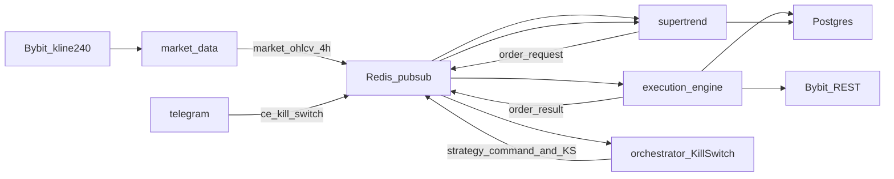
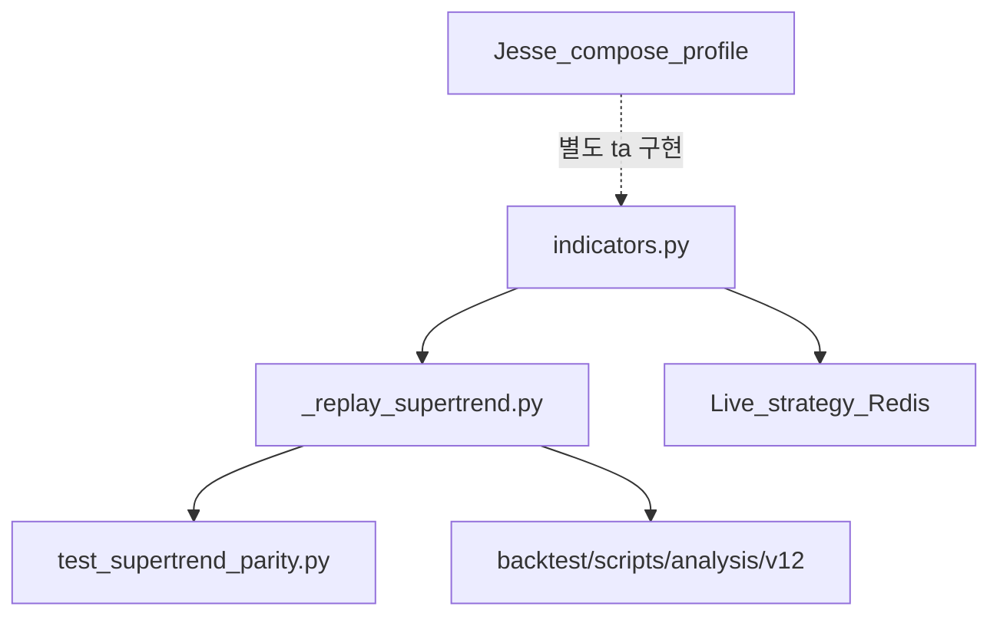

# Supertrend 단일 전략 런타임 단순화 계획

> 이 문서는 2026-10-05 승인된 계획 본문이다. 운영 컨테이너, 전략 파라미터, Kill Switch 코드는 이 문서 작성으로 수정하지 않는다. 구현은 사용자가 1단계를 실행하라고 말한 뒤에만 시작한다.

**Goal:** Supertrend 4h BTC·Bybit 메인넷이 지금처럼 안전하게 도는지 유지하면서, 실제로 CPU/메모리를 먹는 잉여와 멀티전략 시대의 버스 잔재를 구분하고, 무엇을 지금 지우고 무엇을 남겨야 하는지 실행 가능한 단계로 고정한다.

**Architecture:** 1단계는 프로세스 경계를 유지한 채 소비자 없는 시세와 관측 스택만 줄인다. 2단계는 시세·전략·체결·Kill Switch를 한 asyncio 프로세스로 합치고 내부 pub/sub를 함수 호출로 바꾸는 설계이며, 메인넷 포지션이 있는 동안 시작하지 않는다. 백테스트의 기준선은 `indicators.py`를 라이브러리로 임포트하는 리플레이이며, Jesse Compose는 레거시로 유지한다.

**Tech Stack:** Python asyncio, Docker Compose, Redis 7 (유지), Postgres 16 (유지), Bybit WS/REST, 기존 pytest 패리티·주문 상태 테스트.

**Spec:** 사용자 요청(2026-10-05). 전략 확정·거래소 확장 없음. 안정 운영과 백테스트 유지가 목적. Redis pub/sub 필요성에 대한 답과 CPU/메모리 낭비 제거가 본문이다.

## Global Constraints

아래는 이 계획이 어떤 단계에서도 깨면 안 되는 운영 불변식이다. 출처는 [AGENTS.md](../AGENTS.md)와 라이브 코드.

- `BYBIT_TESTNET=false`. 테스트넷 전환은 포지션 수동 청산 후에만.
- [`cryptoengine/shared/kill_switch.py`](../cryptoengine/shared/kill_switch.py) 로직 수정 금지. 호출만 한다.
- 레버리지 하드캡 `SAFETY_LEVERAGE_LIMIT=3.0`. 진입 주문은 SafetyGuard가 초과를 막는다.
- BTCUSDT 단일. 다중 심볼 거래 추가 금지.
- 지정가·post-only 우선. 시장가는 긴급 청산과 리페그 소진 후에만.
- 배분은 고정 95%×3x. 레짐 배분을 되살리지 않는다.
- 배포·재시작은 포지션을 청산하지 않는다. `service_shutdown`은 `_SHUTDOWN_NO_LIQUIDATE`에 들어 있다.
- 브랜치는 `main`만. 피처 브랜치를 만들지 않는다.
- 콤보 #7908 파라미터(st_factor 2.6, st_period 9, EMA 7/29, dir_ema 240, ATR 3.3, 4h 확정봉)를 이 단순화로 바꾸지 않는다.
- 코드 변경 커밋은 Doc-Sync를 따른다. 이 문서 작성 커밋은 코드 변경이 없으면 `Doc-Sync: 없음`.

## Review Focus

- 리소스 절감과 장애 모드 단순화를 섞어 말하지 않았는지. Redis는 메모리가 아니라 메시지 유실·재시작 레이스의 문제다.
- 1단계가 Kill Switch, 주문 상태머신, 거래소 포지션 동기화, 지표 모듈 경계를 건드리지 않는지.
- 2단계를 1단계와 한 배포로 묶지 않았는지.
- 백테스트가 라이브 Redis에 의존하지 않는다는 전제가 `indicators.py` 임포트 경로를 유지하는 조건인지.

## 결론 (먼저)

Redis pub/sub를 자원 때문에 유지할 필요는 없다. 2026-10-05 단일 샘플에서 `cryptoengine-redis-1`은 **5.2MiB / CPU 2.1%**였다. 지울 이유는 "무거워서"가 아니다.

유지할 이유는 따로 있다. 프로세스가 나뉜 지금 구조에서 Redis는 주문 버스, 4h 봉 전달, 텔레그램 긴급청산, `ce:kill_switch:active` fail-closed 게이트다. [`cryptoengine/services/execution/safety.py`](../cryptoengine/services/execution/safety.py)의 `_check_kill_switch`는 Redis를 읽지 못하면 신규 주문을 막는다. 이 동작을 대체 없이 지우면 메인넷이 열린다.

권고는 두 단계다.

- **1단계 (지금 할 일):** 프로세스와 Redis 계약은 둔 채, 소비자 없는 시세·죽은 채널·관측 컨테이너·이미지 빌드 낭비를 제거한다. 실측 CPU의 큰 조각이 여기 있다.
- **2단계 (별도 승인, 포지션 없는 창):** 시세·Supertrend·체결·Kill Switch를 한 프로세스로 합치고 내부 pub/sub를 함수 호출로 바꾼다. 이득은 RAM 수십~백 MiB와 재시작 레이스 제거다. 비용은 주문·청산·복구 경로를 한 번에 다시 검증하는 것이다. 4h 전략의 평소 CPU는 이미 낮아서, 2단계를 자원 절약으로 정당화하지 않는다.

백테스트는 라이브 메시에 묶여 있지 않다. 기준 경로는 [`cryptoengine/tests/fixtures/_replay_supertrend.py`](../cryptoengine/tests/fixtures/_replay_supertrend.py)가 [`cryptoengine/services/strategies/supertrend/indicators.py`](../cryptoengine/services/strategies/supertrend/indicators.py)를 임포트하는 것이다. 1·2단계 모두 이 파일을 라이브 루프 안으로 흡수하지 않는다.

## 실측 (2026-10-05, docker stats 1회)

한 번의 스냅샷이다. node-exporter CPU는 스크랩 순간 튀었을 수 있어 상시 부하로 단정하지 않는다. 상한(limit)이 아니라 RSS다.

거래 코어:

- `cryptoengine-market-data-1`: CPU 8.82%, 81.7MiB / 128MiB (한도의 64%). 거래 경로에서 CPU·메모리 여유가 가장 나쁘다.
- `cryptoengine-execution-engine-1`: CPU 4.17%, 57.6MiB.
- `cryptoengine-supertrend-1`: CPU 0.58%, 57.4MiB. 4h 전략 본체는 가볍다.
- `cryptoengine-strategy-orchestrator-1`: CPU 0.00%, 40.8MiB.
- `cryptoengine-telegram-bot-1`: CPU 0.61%, 52.4MiB.
- `cryptoengine-redis-1`: CPU 2.06%, 5.2MiB / 96MiB.
- `cryptoengine-postgres-1`: CPU 0.01%, 141MiB. 감사·복구 저장소로 정상 비용.

관측·부가:

- `cryptoengine-prometheus-1`: CPU 2.12%, 76.1MiB.
- `cryptoengine-node-exporter-1`: CPU 9.16%, 17.6MiB. 이 샘플에서 Bit-Mania CPU 1위.
- `cryptoengine-redis-exporter-1`: CPU 0%, 9.8MiB.
- `bitmania-dashboard-dashboard-1`: CPU 3.35%, 29.2MiB.
- `pg-backup` + `log-retention` + `ohlcv-retention`: 합계 약 5MiB, CPU 0%. 프로세스 개수만 많고 자원은 무시 가능.
- `cryptoengine-backtest-postgres`: CPU 0%, 11.9MiB. 백테스트를 안 하는 동안에도 떠 있다.

Bit-Mania 관련 합계는 대략 **586MiB**, CPU 합은 이 순간 한 코어의 약 30% 안쪽이다. 같은 호스트의 다른 프로젝트(againspring 등)가 더 크다. Bit-Mania 안에서 줄일 곳은 Redis가 아니다.

같은 시각 compose limit 합은 약 2.5GiB다. limit은 천장이지 사용량이 아니다. orchestrator 이미지의 lightgbm은 임포트되지 않아 RSS 41MiB에 포함되지 않는다. 의존성 삭제는 런타임 RAM이 아니라 이미지 크기와 빌드 시간이다.

## 라이브 경로 (유지 대상)

확정 4h 봉 하나:



핫패스 밖에서 빼면 안 되는 것:

- 진입 전 `_sync_position_from_exchange`. 포지션 진실은 거래소다.
- `OrderManager` 상태머신, 리페그 잔량, 시장가 폴백은 리페그 소진 후에만.
- 체결 확인 전 포지션을 낙관적으로 바꾸지 않는다. 청산 거절은 재동기화 후 60초에 1회 재시도.
- 진입 체결 시 거래소 쪽 재난 손절. 재시작 시 `recover_stop_losses`.
- orchestrator의 외부 Kill 구독. 2026-08-29 이전에는 `ce:kill_switch` 구독자가 없어 신규 주문만 막히고 포지션이 남았다. [`cryptoengine/services/orchestrator/core.py`](../cryptoengine/services/orchestrator/core.py) `_listen_external_kill`이 그 공백을 메운다.
- `service_shutdown` 시 청산하지 않음. 문서의 `strategy:saved_state:*` 복구는 라이브 `on_stop`이 쓰지 않는다. 재시작 복구는 거래소 포지션 + 체결 엔진 손절 복구 + Postgres `supertrend_signals` 누락봉 확인이다. 문서를 코드에 맞춘다. 스냅샷 복구를 새로 만들지 않는다.

지정가 호가 조회는 체결 엔진이 Bybit REST `get_orderbook`을 직접 호출한다 ([`cryptoengine/services/execution/order_manager.py`](../cryptoengine/services/execution/order_manager.py)). market-data가 Redis에 올리는 `market:orderbook:*`와 무관하다. 그 채널의 구독자는 코드베이스에 없다.

## Redis를 어디까지 남길지

부하가 되는 버스와 안전에 쓰이는 키를 분리한다.

지금 부하가 되는 내부 버스 (2단계에서만 함수 호출로 교체):

- `market:ohlcv:bybit:BTCUSDT:4h`
- `order:request`, `order:result`, `order:result:supertrend-01`
- `strategy:command:supertrend-01` (시작 자본, Kill 시 stop)

안전·운영이라 대체 설계 없이 삭제 금지:

- `ce:kill_switch` 발행과 orchestrator 구독
- `ce:kill_switch:active` (SafetyGuard fail-closed, 텔레그램, [`cryptoengine/scripts/emergency_close_all.py`](../cryptoengine/scripts/emergency_close_all.py))
- execution-engine heartbeat → orchestrator dead-man → SYSTEM Kill
- 잔고 캐시 `cache:wallet_balance` (사이징 입력). 단일 프로세스면 메모리로 옮길 수 있으나 그 전엔 유지.

발행만 있고 구독자가 없어 1단계에서 발행을 끊어도 되는 것:

- `market:orderbook:*`, `market:trades:*`, OI, 롱숏비, `market:liquidations:*` (dashboard 소스에도 참조 없음)
- `system:kill_switch`, `telegram:notification`, `position:reconcile_event`
- `ce:strategy:command` (텔레그램이 내고 orchestrator는 안 듣는다. 끊기 전에 `/start` `/stop`이 이 채널인지 `strategy:command:*`인지 확인하고, 실효 없는 명령이면 핸들러를 고치거나 문서에 죽은 명령으로 표시)
- `ce:alerts:funding`, `ce:alerts:daily_report`, `llm:advisory`

Funding 알림이 텔레그램에 실제로 필요하면 `market:funding`만 남긴다. Supertrend 진입 조건은 funding을 쓰지 않는다.

`shared/redis_client.py`와 Redis 컨테이너는 1단계에서 삭제하지 않는다.

## 백테스트 경계



- 표준 백테스트는 Redis, 라이브 Postgres, market-data 없이 로컬 Python이다. 데이터는 [`cryptoengine/tests/fixtures/btc_4h_extended.csv`](../cryptoengine/tests/fixtures/btc_4h_extended.csv) (Binance spot). 라이브 `ohlcv_history`(Bybit)와 섞지 않는다.
- 기대 기준선: `_replay_supertrend.py` 출력 trades≈198, CAGR≈219%, MDD≈-66.7%, Sharpe≈1.667. 구현 시 현재 출력을 다시 찍어 숫자를 본문에 고정한다.
- Jesse (`backtest/docker`, 프로필 `backtest`)는 지표를 `ta.*`로 따로 계산한다. 탐색은 끝났고, 골든 재생성용으로 이미지와 `strategies/external/SupertrendStrategy.py`는 아카이브하지 않고 둔다. 스윕 compose(`compose.sweep-*.yml`)와 `scripts/optimization/`은 실행 기본 경로에서 빼되 결과 디렉터리는 삭제하지 않는다.
- 지금 떠 있는 `cryptoengine-backtest-postgres`(11.9MiB)는 코드 변경 없이 `docker compose --profile backtest stop`으로 끌 수 있다. tripwire `extend-csv` 전에만 다시 올린다. 이 중지는 운영 판단이라 1단계 코드 커밋에 넣지 않고, 문서의 운영 메모로만 적는다.

침묵의 드리프트 (단순화와 별개로 본문에 경고로 남김):

- 라이브 진입·청산은 `strategy.py`, 리플레이는 `_replay_supertrend.py`, Jesse는 또 다른 파일. 지표만 공유한다.
- `supertrend.yaml`의 `model.st_factor`, `candle_lookback: 300`은 `load_config`가 평탄화하지 않는다. 라이브는 모듈 상수와 `CANDLE_LOOKBACK = 1000`을 쓴다. yaml만 고치면 라이브가 안 바뀐다. 1단계에서는 yaml을 코드에 맞추는 문서 정정만 한다. 1000을 300으로 바꾸면 패리티가 깨진다.
- orchestrator.yaml의 `evaluation_interval_seconds: 300`은 코드가 `loop_interval_seconds`를 읽어 기본값 300을 쓴다. 키 이름만 어긋나 있고 간격은 우연히 같다. 1단계에서 코드가 읽는 키로 맞춘다. 간격 값은 300 유지.
- 수수료: 리플레이 `FEE = 0.00055` 고정. 거래소 yaml과 자동 동기화되지 않는다.

## 1단계 — 낭비 제거 (프로세스 경계 유지)

각 항목은 독립 커밋이 가능하다. 배포는 포지션 확인 후, `service_shutdown` 복구가 로그에 찍히는지 본다. 이미지 재빌드 대상은 실제로 바뀐 서비스만.

### 1A. market-data를 4h 확정봉 수집기로 축소

유지: `kline.240.BTCUSDT` confirm → Redis `market:ohlcv:bybit:BTCUSDT:4h` + Postgres `ohlcv_history`. Supertrend가 시작 시 REST로 1000개를 가져가는 백필과 10분 유예 워치독은 그대로 둔다.

제거 후보 (구독자 없음, 대시보드 미사용):

- WS `orderbook.1`, `publicTrade`
- REST OI, 롱숏비, 청산
- CoinGlass 폴링은 키가 있을 때만이므로 코드 경로를 남기되 기본 기동에서 돌지 않게 이미 되어 있는지 확인하고, 미사용이면 태스크 자체를 뺀다
- ticker는 대시보드·펀딩이 읽는지 구현 전에 한 번 더 grep한다. 읽는 곳이 없으면 ticker도 뺀다. 읽으면 남긴다.

파일: [`cryptoengine/services/market-data/collector.py`](../cryptoengine/services/market-data/collector.py), `funding_monitor.py`, `main.py`, [`cryptoengine/config/exchanges/bybit.yaml`](../cryptoengine/config/exchanges/bybit.yaml)의 orderbook 토픽이 이 수집기와 중복이면 수집기만 수정.

검증: 컨테이너 CPU가 샘플 8.8%에서 떨어지는지 `docker stats`로 재측정. Supertrend가 다음 4h 확정봉을 수신하는 로그. 단위 테스트가 있으면 그 테스트, 없으면 수집기 토픽 목록 테스트 하나를 추가한다. 체결 엔진 리페그 테스트(`test_repeg_partial_fill.py`)는 REST 호가 mock이라 이 변경과 무관하게 초록이어야 한다.

리스크: 중간. 봉 발행 포맷을 바꾸면 전략이 봉을 놓친다. 채널 이름과 confirm 페이로드는 유지하고 다른 토픽만 구독 해제한다.

### 1B. 죽은 publish 제거

위 "발행만 있고 구독자 없음" 목록. Kill 채널과 주문 채널은 제외.

파일: orchestrator `core.py`, `position_tracker.py`, telegram `handlers.py`의 죽은 명령, market-data.

검증: `ce:kill_switch` 구독과 `order:request` 테스트가 그대로 통과. `test_safety_guard.py`, `test_kill_switch.py`, `test_orchestrator_kill_switch_alert.py`.

리스크: 낮음. 다만 텔레그램 명령이 조용히 no-op인 것을 "고친다"며 라이브 start/stop 의미를 바꾸지 않는다. 동작 변경이 필요하면 그 명령만 별도 커밋으로 분리한다.

### 1C. 이미지 의존성

런타임 RSS는 거의 안 준다. 빌드와 이미지 비대 제거다.

- market-data requirements의 TA-Lib, pandas, scikit-learn, 그리고 py 파일이 임포트하지 않는 ccxt. Dockerfile의 TA-Lib C 빌드 스테이지 삭제. 실제 임포트(websockets, aiohttp, asyncpg, redis, pydantic, structlog, yaml, orjson)만 남긴다.
- orchestrator requirements의 lightgbm, scikit-learn, pandas. numpy는 `portfolio_monitor.py`가 쓴다.
- supertrend requirements의 TA-Lib. 지표는 numpy/pandas만 사용한다고 코드 주석에 있다. 삭제 전 `import talib` grep으로 재확인.

검증: 각 이미지 빌드, 컨테이너 기동, heartbeat. supertrend는 `pytest tests/unit/test_supertrend_parity.py`.

리스크: 낮음. 숨은 임포트가 있으면 기동 시 ImportError로 바로 보인다. 메인넷 재시작 전에 이미지 로컬 기동으로 확인한다.

### 1D. 관측 스택

Prometheus + node-exporter + redis-exporter는 이 샘플에서 약 103MiB이고 node-exporter가 CPU 샘플 1위다. 대시보드 `alertEvaluator`가 Prometheus를 읽는다. 익스포터를 그냥 내리면 알림 평가가 빈다.

선택지 (본문에 권고를 적고, 구현 시 기본은 A):

- A. 유지하되 scrape 간격을 15초보다 길게 하고 node-exporter 콜렉터를 필요한 것만 남긴다. 동작 변화 최소.
- B. compose profile `obs`로 빼고 기본 `up`에서 제외. 대시보드 알림은 텔레그램 경로만 남는다. 운영자가 대시보드 경보를 포기할 때만.

1단계 기본값은 A다. B는 대시보드 경보를 포기한다는 명시가 있을 때만.

cron 3개 통합은 RSS가 5MiB라 우선순위를 낮춘다. 하고 싶다면 한 `ops-cron`에 백업 17:00 UTC, 로그·ohlcv 보존 18:00 UTC를 그대로 넣는다. 스케줄 값을 바꾸지 않는다.

### 1E. 설정·문서 드리프트

- `strategy:saved_state`를 런타임 복구 설명에서 제거. 스위치 스크립트의 키 삭제 패턴은 옛 잔여 키 청소로 남겨도 된다.
- `supertrend.yaml`의 죽은 `candle_lookback: 300`과 중첩 `model:`이 라이브에 적용되지 않음을 strategy 정책 문서에 명시. 값의 권위는 코드 상수 `#7908`과 `CANDLE_LOOKBACK=1000`.
- orchestrator yaml 키를 `loop_interval_seconds: 300`으로 정리. 숫자 300 유지.
- `docs/cryptoengine/50-api.md`의 구독자 표가 orchestrator가 OI·청산을 구독한다고 적혀 있으면 코드에 맞게 고친다. `stream:market_data`가 40-data에 남아 있으면 스트림이 없다는 쪽으로 고친다.

Doc-Sync: 1A~1D가 코드를 바꾸면 [`docs/_index.md`](../docs/_index.md) 트리거 2, 12, 13, 14, 18, 20에 따라 `docs/cryptoengine/20-containers.md`, `50-api.md`, `30-components.md`, 필요 시 `docs/shared/20-containers.md`. `kill_switch.py`는 안 건드리므로 safety.md 정책 문장은 유지하고, 채널 표만 바뀌면 50-api와 60-runtime의 채널 목록을 맞춘다.

검증: `python3 scripts/lint_docs.py`.

### 1단계 테스트 묶음

```bash
cd cryptoengine
pytest tests/unit/test_supertrend_parity.py \
  tests/unit/test_strategy_state_sync.py \
  tests/unit/test_order_manager.py \
  tests/unit/test_repeg_partial_fill.py \
  tests/unit/test_safety_guard.py \
  tests/unit/test_kill_switch.py -q
pytest tests/integration/test_reject_resync_flow.py -q
python tests/fixtures/_replay_supertrend.py
```

배포 후: `docker compose logs --tail=50 supertrend`에서 복구, `docker stats`로 market-data CPU 재측정. 포지션은 텔레그램 `/positions`로 배포 전과 동일해야 한다.

## 2단계 — 단일 프로세스 (지금 실행하지 않음)

시작 조건: 1단계가 메인넷에서 한 봉 이상 동안 이상 없음. 열린 포지션이 없거나, 포지션이 있어도 청산하지 않는 재시작 리허설을 테스트넷이 아닌 코드 리뷰와 단위·통합 테스트로 끝낸 뒤 운영자가 별도로 승인.

목표 모양:

- 컨테이너 `cryptoengine-live` 하나: WS 4h 수집 → 지표 → 주문 함수 호출 → 기존 OrderManager/SafetyGuard/PositionTracker/StopLoss.
- `KillSwitch` 클래스는 파일 그대로 두고 `trigger_manual` / 포트폴리오 체크를 같은 프로세스에서 호출.
- 신규 주문 게이트는 프로세스 안 플래그 + Postgres에 active 영속. Redis가 죽어서 주문을 막던 fail-closed를, 플래그를 읽지 못하면 막는 형태로 유지. `kill_switch.py` 내부 판정식은 수정하지 않고, SafetyGuard의 조회 위치만 바꾼다. 이 변경은 safety.md에 조회 저장소가 바뀌었다고 적는다. 임계값·4단계는 그대로다.
- 텔레그램은 사이드카로 남긴다. `/emergency_close`는 Redis publish 대신 라이브 프로세스의 로컬 HTTP(루프백)로 `trigger_manual`을 호출하고, active 플래그가 먼저 선 뒤에 청산이 나가게 한다. 2026-08-29자 "구독자 없음" 사고를 다시 만들지 않는 것이 완료 조건이다.
- dead-man: 프로세스가 하나면 "EE heartbeat 부재"는 자기 자신이라 의미가 없다. 대신 프로세스 다운은 Docker `restart: always`와 텔레그램 침묵 알림으로 대체한다고 문서에 쓴다. 프로세스 내부 주문 루프 정지는 기존 예외 알림을 유지한다.
- Postgres는 남긴다. 주문·포지션·시그널·kill 이벤트.
- Redis는 2단계 끝에서 제거 후보가 된다. 대시보드가 Redis 키를 읽는 동안에는 캐시용으로 남기거나, 대시보드를 Postgres/HTTP로 옮긴 뒤 제거한다. 제거는 2단계의 마지막 커밋이며 기본 범위에서 빼 둔다.
- `indicators.py`의 함수 시그니처와 패키지 경로 `services.strategies.supertrend.indicators`는 유지한다.

하지 않는 설계:

- 전략 프로세스 안에 Kill Switch를 약화하거나 파일 로직을 다시 짜기.
- 주문 상태머신을 단순화하며 리페그·잔량·거절 재시도를 빼기.
- 백테스트 리플레이를 라이브 `strategy.py` 한 벌로 합치기. 맞추고 싶으면 별도 과제다. 이 단순화의 범위 밖이다.

2단계 검증은 1단계 묶음에 더해 `test_engine_rejection_alert.py`, `test_engine_trade_alert.py`, `test_execution_flow.py`, 그리고 긴급청산 HTTP가 active를 먼저 세우고 ACK를 반환하는 테스트. 배포 순서는 오늘처럼 서비스별이 아니라 단일 컨테이너 한 번이며, 기동 시 거래소 포지션 재동기화 로그가 필수다.

## 하지 않을 것

- Redis를 1단계에서 제거.
- orchestrator를 Supertrend 프로세스에 1단계에서 병합. dead-man과 외부 Kill 구독이 그 프로세스에 있다.
- Postgres 제거 또는 핫패스를 Redis-only로 전환.
- combo #7908, 룩백 1000, 레버리지 3, 95% 배분, ATR 배수 변경.
- `cryptoengine-backtest-postgres` 데이터 볼륨 삭제, 스윕 결과 디렉터리 삭제, `indicators.py` 이동.
- 멀티 거래소·멀티 전략 추상화를 "나중에 대비"로 다시 키우기. `ExchangeConnector`의 Bybit 단일 레지스트리는 얇아서 1단계에서 지우지 않는다. 지우는 비용이 이득보다 크다.
- 피처 브랜치.

## 실행 순서 (문서가 승인된 뒤, 별도 구현 요청이 있을 때)

1. 1E 문서 드리프트만 먼저 (동작 변경 없음).
2. 1C 의존성 (빌드 확인 후 재시작).
3. 1B 죽은 publish.
4. 1A 시세 축소 후 stats 재측정.
5. 1D는 A안만. B안은 질문으로 남긴다.
6. 2단계는 이 문서의 절로만 존재하고 구현 착수하지 않는다.

구현 착수는 사용자가 1단계를 실행하라고 말한 뒤다. 이 문서 저장은 운영 코드를 바꾸지 않는다.
