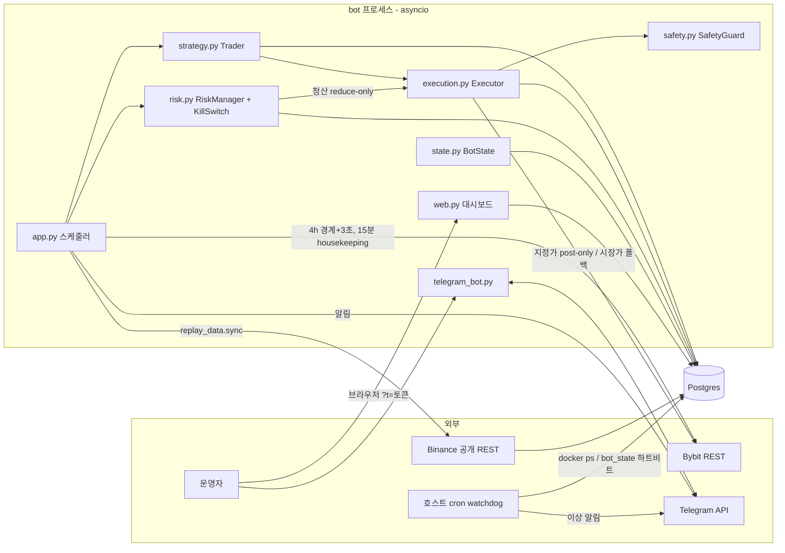

# 아키텍처

Supertrend 4h 롱 전용 BTC 자동매매. **한 개의 Python asyncio 프로세스(`bot`) + Postgres**가 전부다. Redis·pub/sub·웹소켓·Prometheus·별도 대시보드 서비스는 없다. 코드는 `cryptoengine/bot/`, 안전 로직 `cryptoengine/shared/kill_switch.py`만 `shared/`에서 가져온다.

## 컨테이너

`cryptoengine/docker-compose.yml` (프로젝트명 `cryptoengine`, 볼륨 `pgdata`, `pg-backups`).

| 서비스 | 역할 | 비고 |
|---|---|---|
| `postgres` | postgres:16-alpine | `127.0.0.1:5432`, 볼륨 `pgdata` |
| `bot` | `python -m bot.main` (이미지 `bot/Dockerfile`) | 포트 `${DASHBOARD_PORT:-3000}:3000`, 메모리 384M, `stop_grace_period: 450s`, 헬스체크 `/tmp/heartbeat_ok` 25분 |
| `pg-backup` | 매일 02:00 KST `pg_dump`, 7일 보존 | 볼륨 `pg-backups` |

네트워크 노출: postgres는 `127.0.0.1:5432`만, `bot`의 대시보드 포트는 compose가 모든 인터페이스(`0.0.0.0`)에 연다(`/` 요약은 토큰 인증, 원본 `/supertrend`는 옛 구성과 같이 토큰 없음). 호스트 cron의 `scripts/watchdog.sh`가 유일한 외부 감시자다 ([operations.md](operations.md)).

## 데이터 흐름

## 프로세스 구조

모든 모듈은 한 이벤트 루프에서 돈다. 협력자는 생성자 주입이고 `bot/interfaces.py`에 계약(Exchange, Executor, Notifier, EntryGate, BotControl)이 있다.

| 모듈 | 책임 |
|---|---|
| `main.py` | 환경변수 검증(`BYBIT_TESTNET`이 정확히 `false`가 아니면 기동 거부), 배선, SIGTERM/SIGINT 처리 |
| `app.py` | `BotApp`: 시작 절차, 스케줄러 루프, housekeeping, 일일 리포트, `BotControl`(status, emergency_close, resume), 종료 |
| `strategy.py` | `evaluate()`(순수 신호 계산), `Trader`(봉 처리, 진입/청산, 같은 봉 재시도, 쿨다운, 포지션 동기화) |
| `indicators.py` | Supertrend/EMA/ATR (numpy/pandas, TA-Lib 미사용; Jesse와 수치 일치) |
| `execution.py` | `OrderExecutor`: post-only 지정가 re-peg 상태기계, 시장가 폴백, 고아 주문 정리, `orders` 테이블 기록 |
| `exchange.py` | `BybitConnector`: ccxt REST (웹소켓 없음) |
| `safety.py` | `SafetyGuard`: 주문 전 검사 |
| `risk.py` | 에쿼티 고점·낙폭, `KillSwitch` 호출, 청산/차단/쿨다운, 수동 정지, 스냅샷 |
| `state.py` | `BotState`: `bot_state` 키-값 + `EntryGate` |
| `db.py` | asyncpg 풀, 모든 DDL (`CREATE TABLE IF NOT EXISTS`) |
| `notify.py`, `telegram_bot.py`, `report.py` | 알림, 명령(long polling), 일일 리포트 |
| `web.py`, `web_static/index.html` | 읽기 전용 요약 대시보드 `/` (aiohttp, 토큰 인증) |
| `web_supertrend.py`, `web_static/supertrend/` | 원본 `/supertrend` 대시보드 복원: 정적 파일은 옛 Node 대시보드 그대로(수정 금지), `/api/internal/supertrend/*` JSON은 옛 서버와 같은 SQL·형식, 토큰 없음, 읽기 전용. 옛 Redis 3키(`strategy:status:*`, `ce:positions:all`, 진행 중 4h 봉 캐시)는 `make_providers`가 봇 상태·거래소(캐시 10~30초)에서 만든다 |
| `replay_data.py` | Binance 현물 4h → `replay_ohlcv_4h` |
| `cli.py` | `python -m bot.cli status / emergency-close / resume` (봇이 죽어 있을 때도 거래소·DB에 직접 동작) |
| `logging_setup.py` | structlog JSON stdout. ERROR 이상은 Telegram 이상 알림으로도 전송(120초 중복 제거) |

## 스케줄러 (`app.py`)

시작(`BotApp.start`) 순서:

1. 거래소 연결, `set_margin_mode(isolated)`, `set_leverage(3)` (실패해도 로그만 남기고 계속)
2. `executor.start()` — 이전 실행의 고아 미체결 주문 취소
3. `state.load()`, 쿨다운 복원, `risk.load()`(고점·킬스위치 상태 복원)
4. `trader.sync_position("on_start")` — 거래소 포지션이 진실
5. REST로 확정 봉 1000개 로드(진행 중인 마지막 봉 제외), `ohlcv_history`에 `DO NOTHING` 저장, `supertrend_signals`의 `MAX(bar_ts)`로 놓친 봉이 있으면 최신 확정 봉 평가(`process_missed_bar`)
6. 서비스 시작(Telegram 명령, 대시보드), 시작 메시지 전송

루프(`tick`, 최대 60초 간격): `bot_state` 재적재(CLI 변경 반영) → 하트비트 → 봉 처리 → (15분마다) housekeeping → (UTC 자정) 일일 리포트.

- **봉 처리**: UTC 00/04/08/12/16/20시 경계 + 3초에 시작. 방금 마감된 봉이 REST에 나타날 때까지 5초마다 재조회. 10분 지나도 없으면 이상 알림 1회 후 1분마다 계속 재시도. 확보되면 `Trader.on_bar` → 최근 3봉을 `ohlcv_history`에 upsert → `replay_data.sync` (예외는 삼킴).
- **housekeeping (15분)**: 포지션·잔고 조회 2회, 거래소 쪽 포지션 소멸/출현 감지(스톱 체결·수동 거래) 후 정합 + 알림, 리스크 평가, `portfolio_snapshots`(최대 시간당 1행, 체결 직후는 즉시), 하트비트. 조회가 연속 3회 실패하면 이상 알림.
- **하트비트**: 매 tick `bot_state['heartbeat']`를 갱신하고 `/tmp/heartbeat_ok`를 touch. `on_bar` 안에서 주문이 진행되는 동안(`Executor.execute`, re-peg 최대 20회×10초, 주문 타임아웃 420초)에는 루프가 막혀 하트비트가 수 분 멈출 수 있다 — 그래서 헬스체크·watchdog 한도가 25분이다.
- **종료(SIGTERM)**: 같은-봉 재시도 취소, 서비스 정지, 거래소 연결 종료. 포지션은 절대 청산하지 않는다.

## Postgres 테이블

모두 `db.py`의 `ensure_schema()`가 기동 시 `IF NOT EXISTS`로 만든다. 기존 5개는 기존 컬럼 그대로 이력을 유지한다.

| 테이블 | 내용 | 쓰는 곳 |
|---|---|---|
| `orders` | 주문(request_id UNIQUE), 상태·체결수량·체결가·수수료 | `execution.py` |
| `positions` | 포지션 행. 진입 시 open, 청산 시 `closed_at`·`close_reason` | `strategy.py`, `cli.py` |
| `supertrend_signals` | 확정 봉마다 신호 1행 (`bar_ts` 유니크) | `strategy.py` |
| `portfolio_snapshots` | 에쿼티·낙폭·30일 샤프 | `risk.py` |
| `ohlcv_history` | Bybit BTCUSDT 4h 확정 봉 (`timestamp` = 봉 **시작** 시각) | `app.py` |
| `bot_state` | 재시작 후에도 유지할 키-값(JSONB) | `state.py` 등 |
| `replay_ohlcv_4h` | Binance **현물** BTCUSDT 4h (replay 백테스트 입력, `ts` ms) | `replay_data.py` |
| `replay_reference_trades` | #7908 기준 거래 목록 | `replay_data.py import-trades` |

`ohlcv_history`(Bybit 무기한)와 백테스트 DB `jesse_db.ohlcv_4h`·`replay_ohlcv_4h`(Binance 현물)는 별개 소스다. 같은 timestamp라도 값이 다를 수 있다(종가 평균 약 +0.05%) — 대조 시 감안한다.

`ohlcv_history`에는 4h만 쓴다(옛 시스템의 보존 정리 컨테이너가 지우던 비-4h 행은 더 생기지 않는다). 로그는 Postgres에 쓰지 않는다(옛 `service_logs` 없음) — 로그는 컨테이너 stdout(`docker compose logs bot`, json-file 10MB×5).

### `bot_state` 키

| 키 | 값 | 설명 |
|---|---|---|
| `heartbeat` | `{"at": ISO}` | 매 tick. watchdog은 행의 `updated_at`을 본다 |
| `manual_halt` | `{"active", "by", "at", "reason"}` | 수동 정지. `/resume` 전까지 진입 차단 |
| `portfolio_block_until` | `{"until": ISO, "reason"}` | 포트폴리오 킬스위치 쿨다운 동안 진입 차단 |
| `kill_switch` | `{"level", "level_name", "reason", "triggered_at", "alert_only"}` | 킬스위치 상태 (재시작 복원) |
| `risk_peaks` | `{"daily","weekly","monthly", "*_key"}` | 기간별 에쿼티 고점과 기간 키 |
| `peak_rebase_at` | ISO | 마지막 고점 재설정 시각 (고점 재구성이 이전 스냅샷을 무시) |
| `last_liquidation_ts` | ms | 마지막 청산 확정 봉 시각 (같은 봉 재진입 방지) |
| `atr_cooldown_until` | ms | ATR 손절 후 1봉 진입 금지 기준 |

## 주문 실행 (`execution.py`)

- post-only 지정가를 REST 호가창의 best bid/ask에 걸고, 10초마다 최대 20회 re-peg(부분체결 누적, 잔량만 재발주). 소진 시 **잔량만** 시장가 1회(0.001 BTC 단위로 내림, 최소 수량 미만은 버림).
- `request_id` 멱등. 시작 시 고아 주문 취소.
- 진입 주문은 인라인 스톱로스 `price × (1 − 0.70 / 3)`를 포지션 단위 스톱으로 싣는다. 청산 체결 후 거래소가 flat이면 잔여 조건부 주문 취소를 시도한다.
- `BOT_DRY_RUN=1`이면 주문을 거래소로 보내지 않고 `dry_run` 사유로 거부 결과를 돌려준다.
