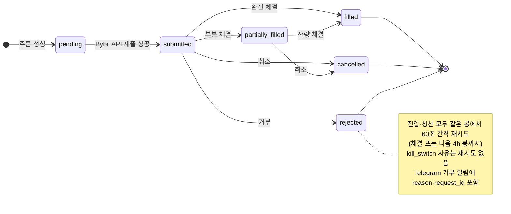
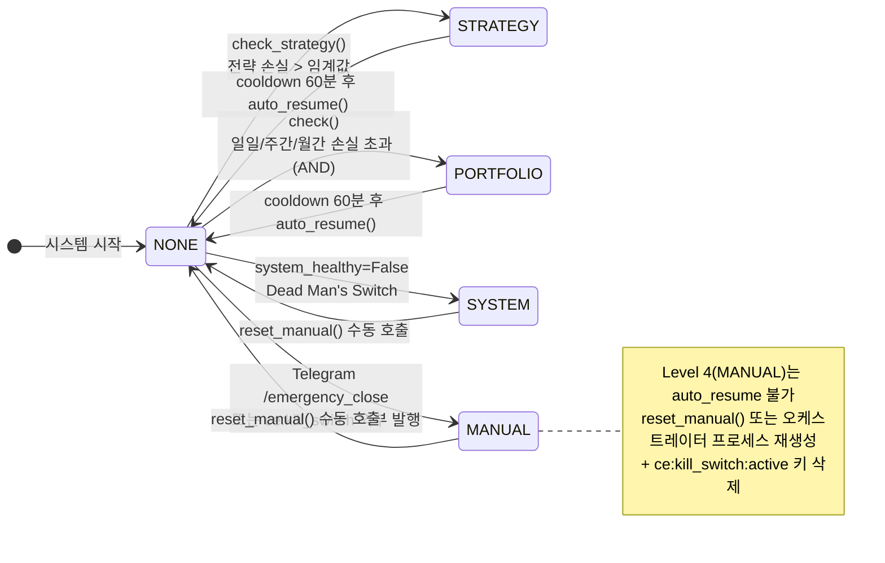
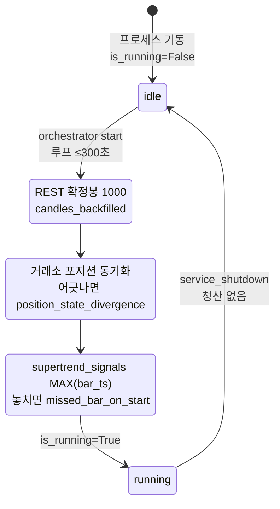

# L6 Runtime — 상태 전이 · service_shutdown 복구

> 주문 상태, Kill Switch 레벨, 서비스 복구 흐름의 완전한 상태 다이어그램 및 전이 규칙.

---

## §1. OrderState 내부 (Diagram K1)

<!-- last-verified: 2026-08-29 -->
<!-- code-ref: cryptoengine/services/execution/order_manager.py:36 -->

### 내부 `OrderState` vs 외부 `OrderResult.status` 매핑

| 내부 OrderState | 외부 OrderResult.status | 비고 |
|---|---|---|
| pending | — | 내부만 (Bybit 미인식) |
| submitted | new | Bybit 접수 확인 |
| partially_filled | partially_filled | 부분 체결 |
| filled | filled | 완전 체결 |
| cancelled | cancelled | 취소 |
| rejected | rejected | 거부 |
| — | expired | Bybit 만료 (내부 enum 없음) |

### `filled`/`partially_filled` 도달 시 텔레그램 알림 발행 (2026-09-19~)

`_process_order()`가 `filled`/`partially_filled` 결과를 받으면, `_publish_result()`(전략 피드백 + DB 저장) 직후 `_publish_trade_alert()`가 `ce:alerts:entry`(진입) 또는 `ce:alerts:exit`(청산, 근사 실현손익 포함)로 발행한다 — **반드시 `position_tracker.on_order_fill()` 호출보다 먼저** 실행되도록 순서가 고정돼 있다(`on_order_fill()`이 포지션 캐시의 진입가를 갱신/삭제해 그 뒤엔 청산 손익·보유시간을 복원할 수 없기 때문). 이전에는 이 발행 코드 자체가 없어 체결 성공 시 텔레그램에 아무 알림도 가지 않았다(실패/거부만 `ce:alerts:anomaly` 경유로 도달). 상세: `docs/cryptoengine/50-api.md` §1/§2.

---

## §2. KillLevel 상태 전이 (Diagram K2)

<!-- last-verified: 2026-08-29 -->
<!-- code-ref: cryptoengine/shared/kill_switch.py:42, cryptoengine/config/orchestrator.yaml, cryptoengine/services/orchestrator/core.py -->

### Phase 5 임계값 (cryptoengine/config/orchestrator.yaml §phase5)

| 주기 | 퍼센트 | 절대값 | 발동 조건 |
|---|---|---|---|
| 일일 | -5% | -$10 | AND (둘 다 초과) |
| 주간 | -10% | -$20 | AND |
| 월간 | -15% | -$30 | AND |
| cooldown | — | — | 60분 |

**ACK 프로토콜**: `ACK_TIMEOUT_SECONDS=5`, `ACK_MAX_RETRIES=3`

### PORTFOLIO/STRATEGY 발동 시 전략 `on_stop()` — position 진실 동기화 (2026-09-18~)

Kill Switch가 전략에 stop을 보내면 `on_stop()`은 청산 여부를 정하기 전 `get_position()`으로 거래소 실포지션을 확인한다(§8 상세는 `strategy.md` §8). 2026-09-16 사고(PORTFOLIO 발동 2건, 09-07·09-15 — 상세는 `strategy.md` §8 사고 기록)에서 이 조회가 매번 실패했음에도 원인을 알 수 없었던 문제를 계기로, 1초·2초 간격 3회 재시도 + 실패 시 예외 종류·메시지 로깅을 추가했다(`cryptoengine/services/strategies/supertrend/strategy.py:_sync_position_from_exchange`). 재시도로도 실패하면 기존 내부 상태를 유지하는 기존 동작(§8 표)은 그대로다 — Kill Switch 로직·쿨다운·auto_resume은 무변경.

### 발동 시 텔레그램 리치 알림 (2026-09-19~)

`_on_kill_switch_trigger`(NONE→STRATEGY/PORTFOLIO/SYSTEM/MANUAL 전이 전부가 거치는 공통 콜백)가 기존 `system:kill_switch`(내부 서비스용) 발행 직후 `ce:alerts:kill_switch`에도 발행한다 — Level·Action·Trigger·Daily/Weekly DD를 보여주는 전용 텔레그램 포맷터가 이제부터 실제로 쓰인다(이전엔 발행자가 없어 `log.critical` → `ce:alerts:anomaly` 경유로만 간접 도달해 상세 없이 표시됐다). Kill Switch 로직 자체(`shared/kill_switch.py`)는 무변경. 상세: `docs/cryptoengine/50-api.md` §1/§2.

---

## §3. service_shutdown 복구 흐름 (Diagram K3)

<!-- last-verified: 2026-10-06 -->
<!-- code-ref: cryptoengine/services/strategies/supertrend/strategy.py:73, cryptoengine/services/strategies/supertrend/strategy.py:131, cryptoengine/services/strategies/base_strategy.py:299, cryptoengine/services/orchestrator/core.py:64 -->

### 복구 핵심 코드

- **청산 제외 사유**: `_SHUTDOWN_NO_LIQUIDATE = frozenset({"service_shutdown"})` — 이 사유 시 청산 없음
- **포지션 상태**: `positions.close_reason` — `signal | stop_loss | kill_switch` (service_shutdown 없음 = 청산 미발생)
- **복구 경로**: supertrend는 기동 직후 `is_running=False`다. orchestrator `start`(루프 ≤300초, `loop_interval_seconds`)가 `on_start`를 호출한다. `on_start`는 REST로 확정봉 1000개(`CANDLE_LOOKBACK`)를 백필하고, 거래소 포지션을 동기화한 뒤, `supertrend_signals`의 `MAX(bar_ts)`로 놓친 봉을 확인한다. Kill cooldown 중이면 orchestrator가 `start`를 건너뛴다.
- **기동·워치독 로그**: `candles_backfilled`, `missed_bar_on_start`, `position_state_divergence`, `bar_watchdog_recovered`. `bar_watchdog_recovered`는 봉 피드 워치독이 REST로 확정봉을 되살릴 때 남는다.
- **손절 주문**: execution-engine `recover_stop_losses`는 `cache:stoploss:*`로 거래소 스탑을 다시 건다. 전략 재시작 경로와 별개다.

`strategy:saved_state`를 쓰거나 읽는 코드는 없다. 재시작이 1시간을 넘겨도 그 TTL로 복구가 끊기지 않는다. 스위치 스크립트가 `strategy:saved_state:*`를 지우는 것은 잔여 키 청소다.

**Dead Man's Switch와 혼동하지 말 것**: EE 하트비트 미수신 **5분** → KillLevel SYSTEM. 재시작 지연과 1시간 제한은 이 발동 조건이 아니다. Postgres만 잠시 내려도 EE 프로세스가 살아 있으면 dead-man은 발동하지 않는다 (D1 tar 시 EE 유지).

### 알려진 공백 — S5. ATR 쿨다운은 메모리에만 있다

`_last_liquidation_ts`와 `_atr_cooldown_until`은 프로세스 메모리에만 있다. ATR 손절 직후 supertrend를 재시작하면 같은 봉 재진입 방지가 사라진다. **ATR 손절 직후 다음 4h 봉 전에는 supertrend를 재시작하지 않는다.** 쿨다운 길이(1봉)와 다른 정책 임계값은 그대로다.

---

## §4. 외부 킬스위치 수신 (2026-08-29)

<!-- last-verified: 2026-08-29 -->
<!-- code-ref: cryptoengine/services/orchestrator/core.py -->

2026-08-29 이전: `ce:kill_switch` **구독자 0**. Telegram이 발행해도 `ce:kill_switch:active`만 서고 포지션은 남음. ACK 타임아웃. `make emergency`는 없는 모듈로 즉시 실패.

현재: `StrategyOrchestrator._listen_external_kill()`이 채널을 구독한다 (`PUBSUB NUMSUB ce:kill_switch` ≥ 1). 페이로드 JSON `trigger_reason` / `triggered_by` → `KillSwitch.trigger_manual()` → 기존 `_on_kill_switch_trigger` → 전략 `stop(reason=kill_switch)`. **`shared/kill_switch.py`는 수정하지 않음.**

`make -C cryptoengine emergency`는 `emergency_close_all.py`를 EE stdin으로 주입: active 키 SET + 채널 PUBLISH + 전략 stop **직접** 발행(오케스트레이터 다운 시 최후 수단). 청산 확인 후에만 ST/orch `stop`.

플랫 북 검증(2026-08-29 18:35 KST): 테스트 페이로드 발행 → `kill_switch_triggered` 로그 → `DEL`/`SET 0` active → ST 먼저 재생성 후 orch. 이후 `is_running=true`.

---

## §5. 전략 `start` 레이스 (`tick_interval` 60s)

<!-- last-verified: 2026-08-29 -->
<!-- code-ref: cryptoengine/services/strategies/base_strategy.py, cryptoengine/config/strategies/supertrend.yaml -->

메인 루프는 커맨드를 짧게 drain한 뒤 `asyncio.sleep(tick_interval)`(60초)한다. 오케스트레이터가 구독 전에 `start`를 발행하면 메시지는 Redis pub/sub 버퍼에 남고, **다음 틱에서** `command_received`가 난다. 대시보드 `is_running: false`가 1분 미만 지속될 수 있다.

배포 시 **supertrend를 strategy-orchestrator보다 먼저** 올린다. 상세: [ADR-0010](../shared/90-adr/0010-ops-cleanup-20260829.md).

---
