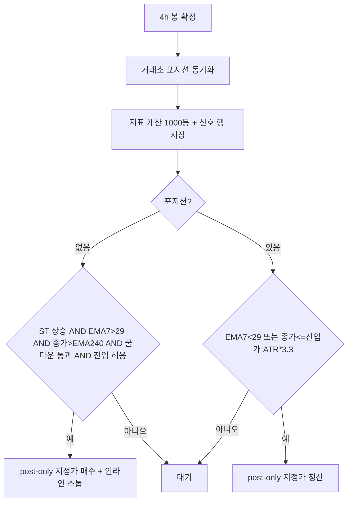

# 전략 — Supertrend 4h Long-Only 3x (combo #7908)

코드 정본은 `cryptoengine/bot/strategy.py`(상수·`evaluate()`)와 `bot/indicators.py`다. 이 문서는 그 사양과 정본 백테스트 수치를 기록한다. 안전·킬스위치는 [safety.md](safety.md).

## 개요

| 항목 | 값 |
|---|---|
| Strategy ID | `supertrend-01` |
| 심볼 | BTCUSDT. **라이브 = Bybit USDT 무기한(선형) 4h**, **백테스트 정본 시세 = Binance 현물 4h** |
| 방향 | Long-only |
| 레버리지 | 3x 하드캡 (`SAFETY_LEVERAGE_LIMIT=3.0`), 마진 모드 isolated |
| 배분 | 항상 전액 95% × 3x (레짐 배분 없음) |
| 평가 시점 | **확정된 4h 봉의 종가**만 (UTC 00/04/08/12/16/20). 형성 중 봉은 사용하지 않는다 |
| 상태 | Phase 5 메인넷 실전 (2026-05-18~) |

## 파라미터 (combo #7908)

| 파라미터 | 값 |
|---|---|
| Supertrend ATR 기간 / 배수 (`ST_PERIOD`/`ST_FACTOR`) | 9 / 2.6 |
| 빠른 EMA / 느린 EMA | 7 / 29 |
| 방향 EMA | 240 |
| ATR 손절 배수 (`ATR_MULT`, ATR 기간 14) | 3.3 (익절 없음) |
| `CANDLE_LOOKBACK` | 1000 (240 EMA 시드 정합) |
| 최소 봉 수 (`MIN_BARS`) | max(9, 240, 29) + 20 = 260 |
| 최소 주문 | 0.001 BTC 그리고 명목가 65 USD |
| 인라인 스톱로스 | `진입가 × (1 − 0.70 / 3)` (= −23.33%) |

지표는 TA-Lib 없이 numpy/pandas로 구현되며 Jesse 2.1.2(combo #7908의 백테스트 엔진)와 수치가 일치하도록 맞춰져 있다: EMA는 `close[0]` 시드 재귀(`jesse_rust.ema`와 동일), ATR은 Wilder `_atr_jesse`(period−1 시드), Supertrend는 정본 포팅(밴드 리셋 + gated flip). 검증: `tests/bot/test_indicator_parity.py`(골든 픽스처 `tests/fixtures/golden_supertrend.json`).

## 진입 (3중 AND, 포지션 없을 때)

1. Supertrend 방향이 상승 (`st_dir == 1`, 종가가 ST 선 위)
2. `EMA(7) > EMA(29)`
3. `종가 > EMA(240)`
4. 쿨다운 통과: 봉 시각 > `last_liquidation_ts` (같은 봉에서 청산했다면 재진입 안 함) 그리고 > `atr_cooldown_until`

수량 = `effective × 0.95 × 3 / 종가`, `effective = min(min(지갑 잔고, max_capital_usd), 총 에쿼티)` (`strategy.py::_capital`). `exchange.get_balance`의 `total`과 `wallet`은 같은 값(Bybit USDT walletBalance, 미실현 손익 제외)이라 실질적으로 `min(지갑 잔고, max_capital_usd)`다. `max_capital_usd`는 `config/bot.yaml`(현재 1000). 0.001 BTC 또는 65 USD 미만이면 진입하지 않는다.

## 청산 (포지션 있을 때)

| 조건 | 트리거 | 사유 값 |
|---|---|---|
| EMA 데드크로스 | `EMA(7) < EMA(29)` — 우선 | `ema_cross` |
| ATR 손절 (하방 전용) | `종가 ≤ 진입가 − ATR(14) × 3.3` | `atr_distance` |
| 익절 | 없음 (2026-08-20 제거). 상승 추세는 데드크로스까지 보유 | — |
| 거래소 스톱 | 진입가 −23.33% 포지션 단위 스톱 (안전망) | — |

ATR 손절이 체결되면 `atr_cooldown_until = 봉 시각 + 4h` — 다음 봉까지 진입 금지(1봉 쿨다운). 모든 청산 확정 시 `last_liquidation_ts = 봉 시각`. 쿨다운은 청산이 **체결 확정**됐을 때만 설정되고 `bot_state`에 저장돼 재시작 후에도 유지된다. 킬스위치/수동 청산(`after_forced_close`)은 쿨다운을 설정하지 않는다.

## 주문 실행 · 상태 동기화

- 진입/청산 모두 post-only 지정가 → 10초마다 best bid/ask로 re-peg, 최대 20회, 부분체결은 누적하고 잔량만 재발주 → 소진 시 잔량 시장가 1회. 시장가 직접 진입은 없다.
- 거래소 포지션이 진실이다: 매 봉 신호 판단 **전**에 `get_position()`으로 동기화하고, 내부 상태는 체결이 **확정**된 뒤에만 바꾼다. 거부·미체결 후에는 거래소에서 다시 동기화한다. 거래소 조회가 실패하면 진입하지 않는다(보이지 않는 이중 진입 방지).
- 같은 봉 재시도: 진입·청산 거부 또는 미체결이면 60초마다 재시도(진입은 신호 재확인 + 잔량만, 먼지 잔량 무시)하며 다음 봉이 오면 취소한다. 거부 사유가 `kill_switch`/`entries_blocked`/`dry_run`으로 시작하면 재시도하지 않는다.
- 진입 확정 시 entry_price는 주문가가 아니라 실체결가로 기록한다 (ATR 손절 정확도).
- 시작 시 `supertrend_signals`의 `MAX(bar_ts)`를 확인해 한 번도 평가되지 않은 최신 확정 봉이 있으면 처리한다.
- 수수료: Bybit maker 0.020% (실측 체결에서 확인), 시장가 폴백 시 taker.

## 정본 백테스트 성과

**데이터 출처 (2026-08-31 정정)**: 정본 백테스트의 시세는 **Binance 현물(spot) 4h**다. (과거 문서는 "Bybit 네이티브 4h"로 적었으나 라벨 오기였다. 2020-03-12·2022-06-15·2026-08-28 각 1,440봉에서 현물 100% 일치, 무기한 0% 일치.) 라이브는 Bybit 무기한이라 거래소도 상품도 다르며, 종가 기준 평균 약 +0.05% 차이가 난다. 같은 구간을 Bybit 데이터로 재실행하면 net +3.1%p, MDD +3.2%p 차이가 났다(34거래 중 32건 동일). **무기한 펀딩비는 현물 캔들에 없으므로 정본 수치에는 펀딩비가 반영돼 있지 않다.** 라이브는 실제로 펀딩비를 지불한다(롱 보유는 일반적으로 지불 쪽, 3x라 명목가 기준 3배). 홀드아웃 구간 실측 영향은 아래 요약 참조.

| 지표 | 값 |
|---|---|
| 기간 | 2017-08-17 ~ 2026-04-30 (약 9년, 19,057봉) |
| CAGR | **+219.06%** |
| Sharpe | **1.667** |
| 최대 낙폭 (MDD) | **−66.70%** |
| 총 거래 수 | **198** (EMA 청산 197 / ATR 손절 1) |
| 승률 / PF | 42.42% / 1.507 |
| 청산 규칙 | EMA 데드크로스 + ATR 손절만 (2026-08-20 규칙) |

구규칙(ATR 대칭 손절·익절) 참고값: CAGR +137.64% / Sharpe 1.349 / MDD −73.29% / 360 거래 — 폐기. Jesse 스윕 window-mean CAGR 281.36%(8 윈도우 산술평균)는 전기간 CAGR과 정의가 달라 비교하지 않는다. 시나리오 가정: MDD −66.70%는 고위험 수치이며 이를 인지하고 채택했다(2026-08-20 사용자 승인).

재현: `make replay ARGS="--until 2026-04-30"` — `tests/fixtures/_replay_supertrend.py`가 Postgres `replay_ohlcv_4h`(또는 `--csv tests/fixtures/btc_4h.csv`)에서 라이브 지표 함수와 #7908 규칙으로 종가 체결, 95%×3x, taker 0.055%/편으로 계산한다. 구 규칙(2026-08-20 이전, ATR 대칭 청산)으로 한 라이브 거래는 이 도구와 구조적으로 일치하지 않는다.

### 파라미터 탐색 결론 (2026-08, 요약)

- v11 로버스트 재스윕(8윈도우 19,944 job): 후보 5개 모두 홀드아웃 리플레이에서 탈락, **#7908 유지**.
- v12 사전등록 반-과적합 스윕(1,536 combo): plateau 0개(NO_PLATEAU), **#7908 유지**.
- 독립 재검증: 설계구간 점수와 홀드아웃(2025-01~2026-08) 순손익의 Spearman ρ = −0.508 — #7908은 "검증된 최적점"이 아니라 우열을 가릴 수 없는 능선 위의 현직이다. **파라미터 탐색 종료를 권고**한다.
- 전방(forward) 기대치는 정본 수치가 아니라 홀드아웃 기준으로 이해한다: CAGR 약 20%대, Sharpe 약 0.6, MDD −50% 이상, 체결이 나쁘면 순손익 0 근처. 정본 CAGR 219%·Sharpe 1.67은 설계구간 수치다.
- 실 체결 슬리피지 실측(2026-07-14~08-29, limit 체결 12건/6 왕복): 왕복 체결비용 중앙값 4.61bps(백테스트 taker 가정 11bps보다 낮음). 이 비용으로 홀드아웃 net +34.29%(최악 관측 10.04bps에서도 +19.67%).
- 펀딩비 반영(Bybit 공개 REST 7,055개 정산, 2020-03-25~2026-09-02): 홀드아웃 net +38.20% → +29.23%(−8.96%p), 부호 불변. 2020-03-25 이전 보유 구간은 0으로 가정(커버리지 밖).
- 엣지 소멸 트립와이어(사전등록): 첫 판정 T1 = WARNING, T2 = n/a (첫 클린 T2 판정 2027-04-01). 체크 스크립트와 판정 로그는 이번 정리에서 작업 트리에서 삭제됐다(git 히스토리에서 복구 가능).
- 엣지 소멸 감시는 현재 자동화돼 있지 않다 (킬스위치는 손실 회로차단기이지 엣지 검정이 아니다).

상세 산출물(`backtest/results/…`)은 작업 트리에서 정리되어 git 히스토리에만 있다. Jesse 백테스트 스택은 `backtest/README.md`.

## 극단 시나리오 (공식 95%×3x 기준)

- BTC 3x 롱에서 대략 −33% 하락이면 청산가에 근접한다. 거래소 스톱(진입가 −23.33%)이 그 전에 포지션을 닫도록 설계돼 있으나, 갭·체결 지연에서는 보장되지 않는다.
- 연속 약세장에서 MDD −66.7%(정본 백테스트) 수준의 낙폭이 가능하다. 킬스위치는 일 −5% AND $10 등 임계에서 청산한다([safety.md](safety.md)).
- 정본 수치는 소액($185~239) 실전 규모에서 최소 주문(0.001 BTC / 65 USD)과 절대값 임계(10/20/30 USD)의 영향을 받는다.
